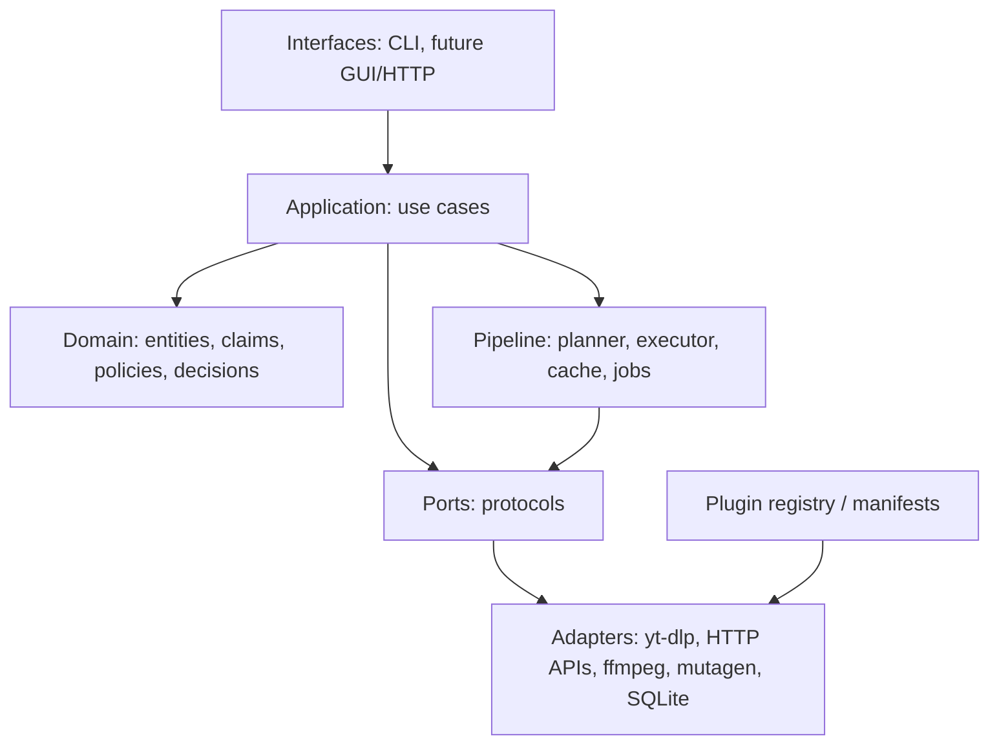

# TrackForge — видение, принципы и границы

> Статус: **черновик v0.3**, не согласован. Документ задаёт «позвоночник» проекта; детали будут в следующих файлах.
> Исходная идея: [`../reflection/start-ideas.md`](../reflection/start-ideas.md).

## 0. Зафиксированные решения первого раунда

| Решение | Значение |
|---|---|
| Продукт | Личный локальный инструмент + переиспользуемая библиотека; Linux, CLI + Python API; GUI позже |
| MVP | Один трек из любого источника: локальный файл или одна ссылка; без плейлистов |
| Запись | Managed library: оригинал не трогаем, копия/импорт, теги в копию, sidecar `trackforge.json` |
| Решения | По умолчанию policy engine + LLM как источник; отдельный режим «LLM решает всё» (autopilot) через API |
| Обратная связь | Все расхождения итога с желанием пользователя сохраняются как события/датасет |
| Интерфейсы | CLI + Python API; GUI позже, через application services |
| Анализаторы | Доступны все; тяжёлые можно явно отключать/пропускать; альтернативные провайдеры; видимая деградация |
| LLM/приватность | Текст — в облако можно; аудио — только opt-in; API — основной LLM; локальный fallback 0.5B — опционально, для classification/ranking |
| Лицензия | GPL-3.0-or-later; GPL/AGPL-зависимости изолируем за портами и optional adapters |

## 1. Одной фразой

**TrackForge превращает аудиофайл или ссылку в объяснимое, воспроизводимое и аккуратно записанное представление трека: метаданные, обложку, текст с таймингами и файл с правильным именем.**

Ключевое слово здесь — **объяснимое**. TrackForge не просто «угадывает теги»; он хранит, откуда взято каждое значение, насколько ему можно верить, какие были альтернативы и почему выбрана именно эта.

## 2. Проблема

Аудио приходит из разнородных источников: локальные папки, YouTube и другие сайты, плейлисты, текстовые описания. Данные о треке при этом:

- **неполные** — где-то нет альбома, где-то исполнителя, где-то обложки;
- **противоречивые** — название на сайте, в тегах файла, в MusicBrainz и в описании могут не совпадать;
- **шумные** — uploader ставит «nightcore», «slowed + reverb», «prod. by…», эмодзи и маркетинговые приписки;
- **производные** — nightcore, remix, cover, sped up, 8D ломают наивное сопоставление «название + исполнитель»;
- **дорогие для повторного получения** — скачивание, ASR, разделение стемов, запросы к LLM нельзя делать заново на каждом шаге.

Готовые инструменты решают части задачи: `yt-dlp` — скачивание, `beets`/Picard — тегирование, `AcoustID`/MusicBrainz — идентификацию, Whisper — транскрипцию. Но нет одного инструмента, который связывает **получение**, **накопление доказательств**, **разрешение конфликтов**, **учёт производных версий** и **объяснимость** в один локальный, прерываемый пайплайн.

## 3. Пользователи и сценарии

### 3.1. Основной пользователь

Технически грамотный владелец личной музыкальной библиотеки, который:

- готов работать из CLI и писать Python-код;
- хочет управляемую библиотеку, а не «магию», которая молча перезаписывает файлы;
- ценит воспроизводимость и возможность посмотреть, почему получился такой результат;
- использует Linux (как минимум на первом этапе);
- возможно, захочет использовать TrackForge как библиотеку в другом проекте.

### 3.2. Вторичные пользователи

- Пользователь будущего GUI, которому нужен тот же функционал без CLI.
- Программист, встраивающий TrackForge в свой сервис через Python API (позже — локальный HTTP API).
- Автор плагинов: новый источник, анализатор или writer.

### 3.3. Сценарии («jobs to be done»)

| Сценарий | Что должно получиться |
|---|---|
| «Вот ссылка на трек — сделай нормальный файл» | Скачанный/скопированный файл с проверенными метаданными, обложкой и предсказуемым именем |
| «Вот папка с бардаком — разбери, но не сломай оригиналы» | Оригиналы не изменены; рядом/в библиотеке появились размеченные копии и отчёт |
| «Вот плейлист — обработай по частям» | План, выбор треков, ограничения по частоте запросов, resume после прерывания |
| «Я помню только описание/исполнителя — найди варианты» | Список кандидатов с источниками и уверенностью, выбор пользователя |
| «Почему здесь такой артист?» | Объяснение: источники, альтернативы, правило, уверенность; возможность переопределить и залочить |
| «Я хочу использовать это из своего кода» | Стабильный типизированный Python API без CLI-зависимостей |

## 4. Что TrackForge *не* делает в v1

Явные non-goals нужны не меньше, чем цели:

- не стриминговый сервис и не замена Navidrome/Spotify;
- не обход DRM и не скачивание платного контента в обход правил площадок;
- не многопользовательский сервер с auth, ролями и изоляцией;
- не рекомендательная система и не «музыкальный интеллект»;
- не мобильное приложение;
- не гарантия «идеального автотегирования без человека» — спорные случаи уходят в review;
- не поддержка «любого сайта»: только `yt-dlp`, официальные/публичные API и явный plugin-интерфейс для остального;
- не DJ-анализ, не real-time, не видеомонтаж;
- не конвертер «во все форматы» — только то, что нужно для выбранного сценария.

## 5. Ключевая идея: evidence-driven resolver

TrackForge — **не downloader**. Скачивание — это один из адаптеров источника. Ядро проекта — превращение наблюдений в решения:

```text
Observation  →  Claim  →  Decision  →  Render
(что измерили)  (что утверждаем)  (что выбрали)  (что записали)
```

Следствия:

1. **Файл — не строка с nullable-полями.** У файла есть содержимое, идентичность (гипотезы о том, что это), доказательства и решения. Старая модель «один dataclass со всеми тегами» не различает факт, догадку и выбор.
2. **Один и тот же трек может иметь несколько «правд».** Например, `title` исходного recording, `title` конкретного nightcore-загрузчика и `fileName` — разные сущности. Их нельзя смешивать в одно поле без потери смысла.
3. **Анализатор не пишет финальные теги.** Он возвращает наблюдения/claims. Финальные значения выбирает policy engine, а не последний вызванный анализатор.
4. **LLM — не истина в последней инстанции.** Это один из источников/арбитров с ограниченными правами, структурированным выводом и обязательной ссылкой на доказательства.

## 6. Принципы, на которые опираемся при принятии решений

Это не «ценности на стену», а фильтры для конкретных архитектурных развилок.

### P1. Сначала доказательство, потом значение

Любое итоговое поле должно раскладываться на цепочку:

```text
значение → claim → источник/метод → артефакт-доказательство
```

Если поле нельзя объяснить, оно не должно автоматически попадать в финал. Оно может попасть в review или остаться `unknown`.

### P2. Наблюдение, интерпретация и решение — разные слои

- **Observation** — сырой измеримый/получаемый факт: вывод `ffprobe`, оценка BPM, сегменты ASR, JSON от `yt-dlp`, ответ MusicBrainz, существующий тег файла.
- **Interpretation** — придание смысла: «это nightcore-версия recording X», «название, вероятно, Y», «артист Z».
- **Decision** — выбор финального значения по политике с учётом альтернатив и пользовательских переопределений.

Сырые наблюдения не перезаписываются интерпретацией. Интерпретацию можно перезапустить без повторного скачивания. Решение можно пересмотреть без повторного анализа. Это одновременно даёт кэш, отладку и evaluation.

### P3. Байты неизменяемы

Оригинальный файл никогда не редактируется по умолчанию. Содержимое идентифицируется хэшем (SHA-256), хранится в content-addressed store и переиспользуется. Всё остальное — производные артефакты и материализованные копии.

Это даёт:

- дедупликацию;
- resume;
- воспроизводимость;
- безопасный dry-run;
- возможность перегенерировать библиотеку из исходников и решений.

### P4. Резолвим по полям, а не трек целиком

У названия, исполнителя, альбома, обложки, даты, жанра и текста разные авторитеты и разные стратегии. Единый «confidence трека» — ложная простота. Политика задаётся на уровне поля (иногда — группы полей), с условиями по типу трека, источнику и контексту.

### P5. Пайплайн — это DAG возможностей, а не захардкоженный список

Каждый шаг объявляет:

- `id` и `version`;
- `requires` — какие типы артефактов/полей нужны;
- `provides` — какие типы артефактов/полей создаёт;
- `cost` — CPU, сеть, деньги, память;
- `determinism` и `cacheability`;
- `config schema`.

Движок сам строит план от желаемого результата, кэширует шаги и позволяет добавить новый анализатор/источник без правки ядра. Это прямой ответ на требование «добавить новый источник/алгоритм должно быть просто».

### P6. Всё идемпотентно и прерываемо

Ключ кэша шага:

```text
hash(входные артефакты) + step_id + step_version + нормализованные параметры + релевантный конфиг
```

Повторный запуск не качает заново и не делает уже сделанные анализы, если пользователь явно не попросил `--force`. Прерывание на любом шаге не ломает состояние: артефакты либо есть целиком, либо их нет.

### P7. Объяснимость — часть результата

У каждого решения есть:

- выбранное значение;
- альтернативы;
- сработавшее правило/политика;
- уверенность и её источник;
- ссылки на доказательства;
- признак `locked` (пользователь зафиксировал вручную).

Это нужно и для доверия, и для отладки, и для будущего GUI.

### P8. Local-first, CPU-aware, privacy-aware

- SQLite + файловая система, без обязательного сервера, Redis или облачной БД.
- Тяжёлые модели — опциональные профили, а не обязательная зависимость.
- Облачные API — только явно включённые, с учётом приватности и стоимости.
- Работа без сети должна быть возможна для уже скачанных материалов (насколько позволяют анализаторы).

### P9. API — первичный интерфейс

CLI и будущий GUI — тонкие клиенты над application services. Публичный Python API типизирован, документирован и версионируется. Внутренние модули можно менять, публичные контракты — только через deprecation.

### P10. Скучные проверенные инструменты, строгие контракты

`yt-dlp`, `ffmpeg`, `mutagen`, MusicBrainz, SQLite, `pydantic`. Никаких фреймворков «на всякий случай», если они не решают конкретную проблему. Сложность добавляем только под доказанную потребность.

### P11. Никогда не терять данные молча

- dry-run по умолчанию для подозрительных операций;
- атомарная запись (temp + fsync + rename);
- backup/undo для in-place сценариев;
- сохранение неизвестных/неподдерживаемых тегов;
- проверка чтением после записи.

### P12. Дисциплина скоупа

Вертикальные срезы: сначала один трек, потом плейлист, потом GUI. Никакого «ML-зоопарка» в v1. Если функция не нужна для текущего среза — она не попадает в код, даже если «когда-нибудь пригодится».

### P13. Обратная связь пользователя — первоклассный артефакт

Каждый случай, когда пользователь изменил решение системы, сохраняется как событие с контекстом: что выбрала система, что выбрал пользователь, какие были claims и альтернативы, версии анализаторов/промптов/политик. Это не «лог ради лога», а датасет для калибровки политик, промптов и приоритетов источников.

По умолчанию журнал обратной связи хранится локально и никуда не отправляется. Он также не должен автоматически «дообучать» систему втихую: изменения политик — явные, версионируемые и объяснимые.

## 7. Конвейер


| Стадия | Вход | Выход | Что кэшируется |
|---|---|---|---|
| **Plan** | `SourceRef`, профиль, желаемый результат | `RunPlan`: кандидаты, коллекция, DAG шагов | План пересобирается; кэш — по source + config |
| **Acquire** | выбранный кандидат | `Intake`, `MediaObject` в CAS, `SourceSnapshot` | По source id + выбранному формату |
| **Observe** | `MediaObject`, `SourceSnapshot` | типизированные `Observation`-артефакты (включая `audio.probe.v1`) | По хэшу медиа + observer id/version + params |
| **Interpret** | наблюдения | `Claim`-ы, `IdentityHypothesis` | По хэшам наблюдений + interpreter version + prompt/model |
| **Resolve** | claims + политики + overrides | `DecisionRecord` | По claims + policy version + overrides; решение всегда пересобираемо |
| **Render** | decisions + медиа | `OutputBundle` (файл, теги, обложка, lyrics, sidecar) | По decisions + renderer version + target format |
| **Publish** | bundle | `LibraryEntry` + запись в каталог | Идемпотентно по bundle hash + целевому пути |

### 7.1. Соответствие исходной идее

| В `start-ideas.md` | В этой модели |
|---|---|
| «Генерация данных» (акустика, вокал, транскрипция, запросы к платформам, thumbnail) | **Acquire + Observe** |
| «Анализ (интерпретация)» (nightcore/remix, LLM по описанию, теги) | **Interpret** |
| «Выбор итоговых значений» | **Resolve** |
| «Копирование в папку с готовыми результатами» | **Render + Publish** |

Важное уточнение: сетевые запросы к MusicBrainz/AcoustID/обложкам — это **наблюдения** (получение данных), а не интерпретация. Их результат можно кэшировать и переиспользовать; интерпретация поверх них дешёвая и перезапускаемая.

### 7.2. Почему не «один большой анализатор»

Соблазн сделать `analyze(file) -> ResolvedData` велик, но он ведёт к:

- невозможности переиспользовать дорогие шаги;
- скрытым зависимостям между анализаторами;
- «последний анализатор победил»;
- трудной отладке и оценке качества.

DAG с явными контрактами решает это ценой небольшой инфраструктуры. Для локального инструмента это оправданная сложность, потому что она напрямую обслуживает resume, кэш и расширяемость.

### 7.3. Режимы принятия решений

Режим — это свойство запуска/профиля, а не глобальная настройка «навсегда». Формат `DecisionRecord` во всех режимах один и тот же.

| Режим | Кто выбирает финал | Роль LLM | Когда использовать |
|---|---|---|---|
| `policy` (default) | Policy engine | Источник claims / арбитр только там, где разрешено политикой | Обычная работа, воспроизводимость, объяснимость |
| `llm_assisted` | Policy engine с LLM-рекомендациями | Предлагает решения по конфликтным полям; policy валидирует | Сложные, но не критичные случаи |
| `llm_autopilot` | LLM | Получает набор claims и выбирает/синтезирует финальные значения | Пользователь явно доверяет LLM и хочет минимум ручной работы |
| `manual` | Пользователь | Только подсказки | Спорные треки, обучение системы |

Правила для `llm_autopilot`:

- LLM выбирает из существующих claims или синтезирует производное значение с явным `derived_from`; он не выдумывает новые MBID/ISRC/URL.
- Пользовательские locks всегда сильнее LLM.
- Структура ответа валидируется схемой; невалидный/неуверенный ответ откатывается в `policy` или review.
- В `DecisionRecord` фиксируются модель, версия промпта, стоимость, входные claim IDs и причина.
- Отключить autopilot можно на уровне профиля, запуска или отдельного поля.

### 7.4. Профили анализа, альтернативы и деградация

Пользователь хочет «всё», но CPU-only и сеть делают это небесплатным. Поэтому анализаторы — это не жёстко включённый список, а **профиль + бюджет + цепочки провайдеров**.

- Профили: `fast` (дешёвые локальные + минимум сети), `balanced` (по умолчанию), `full` (включая ASR/Demucs), плюс точечные `enabled/disabled` для каждого анализатора.
- Для каждого типа артефакта может быть **цепочка альтернатив**: например, lyrics — LRCLIB → Genius → ASR; cover — Cover Art Archive → iTunes → Deezer → thumbnail источника; identity — AcoustID → MusicBrainz search → ranker/LLM-гипотеза.
- **Обязательный выход только один — успешно созданный выходной файл.** Его отсутствие при завершении — ошибка.
- `title` и `artist` — **желательные**, но не обязательные. Если доказательств нет, они могут остаться `unknown`; это не повод падать. Имя файла в таком случае собирается по резервному шаблону.
- Остальные поля (bpm, key, genre, lyrics, cover, mood, language...) — опциональные; при неудаче ставится `degraded` и видимое предупреждение с причиной.
- При недоступности сети/облачного провайдера допустима деградация на:
  - локальную модель 0.5B (только classification/ranking/короткий JSON, не autopilot);
  - **не-генеративную модель выбора из конечного набора вариантов** (ranker/reranker);
  - лексические/эвристические правила.
- Для отключённых тяжёлых анализаторов — упрощённые версии: например, акустика без Demucs, lyrics из LRCLIB вместо ASR, derivative-детектор по метаданным/темпу вместо стемов.
- «Пропустить тяжёлое» — явное действие с записью в артефактах, а не тихий `None`.

## 8. Архитектурные слои



| Слой | Ответственность | Примеры | Чему здесь не место |
|---|---|---|---|
| **Domain** | Понятия и правила предметной области | `Claim`, `Decision`, `FieldPolicy`, `IdentityHypothesis`, `Collection` | HTTP, файлы, SQL, `yt-dlp` |
| **Application** | Сценарии использования и оркестрация | `PlanItem`, `AcquireItem`, `AnalyzeItem`, `ResolveItem`, `RenderItem`, `ImportLibrary` | Детали площадок и форматов |
| **Ports** | Контракты с внешним миром | `SourceResolver`, `Downloader`, `MetadataProvider`, `Observer`, `Interpreter`, `LLMProvider`, `ArtifactStore`, `Catalog`, `TagWriter` | Реализации |
| **Adapters** | Реализации портов | `YtDlpSource`, `MusicBrainzProvider`, `AcoustIdProvider`, `FfmpegProbe`, `MutagenTagWriter`, `SqliteCatalog` | Бизнес-правила |
| **Pipeline** | План, выполнение, кэш, ретраи, конкурентность | `DagPlanner`, `StepExecutor`, `ArtifactCache`, `JobQueue` | Знание о конкретных тегах |
| **Interfaces** | Пользовательские входы | CLI, будущий HTTP/GUI | Логика резолва |

**Правило зависимостей:** `interfaces → application → domain`; `adapters` реализуют `ports`, но не импортируются в `domain`/`application`; `domain` не импортирует ничего из внешних слоёв. Сборка зависимостей — в composition root.

Это **модульный монолит**, а не микросервисы. Один процесс, чёткие границы, возможность later вынести pipeline/HTTP в отдельный процесс без переписывания домена.

## 9. Домен первого приближения

| Понятие | Что это | Зачем |
|---|---|---|
| `SourceRef` | Локальный путь, URL, текстовый запрос | Единый вход для разных источников |
| `Candidate` | Возможный трек/вариант из источника (качество, формат, язык) | Пользователь выбирает до скачивания |
| `Collection` | Плейлист, альбом, канал; упорядоченные элементы + контекст | Плейлист — это не трек, а контейнер с собственными метаданными |
| `MediaObject` | Неизменяемые байты + `probe` + хэш | Идентичность содержимого |
| `IdentityHypothesis` | Гипотеза: это recording X / release Y / derivative Z, с уверенностью | Не смешивать «что это» и «как назвать» |
| `Observation` | Сырой результат измерения/получения | Переиспользуемый факт |
| `Claim` | Утверждение о поле с источником, методом, уверенностью и доказательством | Основная единица резолва |
| `FieldPolicy` | Правила выбора значения для поля | Явная, объяснимая логика |
| `Decision` | Выбранное значение + альтернативы + причина + lock + режим | Результат резолва |
| `DecisionRecord` | Снимок решений по всем полям + версии policy/модели | Воспроизводимость и объяснимость |
| `FeedbackEvent` / `Correction` | Расхождение между решением системы и выбором пользователя | Калибровка, evaluation, аудит |
| `ReviewSession` | Набор полей/элементов, которые пользователь проверял | Не терять контекст правок |
| `Capability` / `ProviderChain` | Описание шага и альтернативных провайдеров | Планирование и деградация |
| `AnalysisProfile` | Набор включённых анализаторов, бюджет, качество | Управление стоимостью на CPU |
| `ResolvedMetadata` | Каноническое представление метаданных | Вход для render |
| `OutputBundle` | Конкретный файл + теги + обложка + lyrics + sidecar | Материализация |
| `LibraryEntry` | Опубликованный элемент библиотеки | Учёт и повторная обработка |
| `Run` / `Step` / `Artifact` | Исполнение, шаг, артефакт | Resume, кэш, диагностика |

### 9.1. Идентичность и производные версии


Упрощённо:

- **Work** — композиция (слова + музыка).
- **Recording** — конкретное исполнение/запись.
- **Release** — альбом/EP/сингл, в котором recording опубликован.
- **Derivative** — результат преобразования recording: nightcore, remix, cover, sped up, 8D и т.п.
- **File** — конкретные байты, которые могут быть оригиналом, производной или частью релиза.

Это разделение нужно, потому что:

- «настоящее название» nightcore-версии и исходного трека — разные вещи;
- артист original recording и uploader derivative-версии — разные роли;
- альбом плейлиста и альбом автора — разные контексты;
- duplicate detection должен сравнивать recordings, а не только строки.

MusicBrainz ID — сильный якорь, но не обязательное условие. Если ID нет, остаются гипотезы с уверенностью.

## 10. Хранилище первого приближения

```text
data_dir/                              # путь настраивается (XDG), внутренние данные
  catalog.sqlite                       # индекс: items, runs, steps, decisions, library
  cas/
    ab/cd/<sha256>                     # неизменяемые байты
  artifacts/
    <cache_key>/
      manifest.json                    # тип, версия, inputs, warnings
      payload.json                     # наблюдение/claims/decision snapshot
  items/
    <item_id>/                         # item_id, не хэш: байты могут прийти из разных источников
      item.json
      intake.json
      claims.json
      decisions/
        <record_id>.json
      renders/
        <render_id>/
          track.m4a
          cover.jpg
          lyrics.lrc
          trackforge.json
  feedback/
    events.jsonl                       # append-only журнал: corrections, approvals, locks
    corrections/
      <correction-id>.json             # снимок контекста для калибровки

library_dir/                           # отдельный root; default: ~/Music/TrackForge
  <artist> - <title> (<qualifier>).<ext>
  <collection-title>/
    <artist> - <title> (<qualifier>).<ext>
```

Принципы:

- **CAS** хранит байты; ничего не перезаписывается.
- **artifacts** — общий кэш наблюдений/интерпретаций по `cache_key`; одинаковые байты переиспользуют артефакты.
- **item workspace** привязан к `item_id`, а не к хэшу: одни и те же байты из разных источников могут иметь разные intake и решения.
- **catalog.sqlite** — индекс и состояние, но не единственный источник правды; артефакты можно перечитать.
- **library** — отдельный user-visible root (по умолчанию `~/Music/TrackForge`), материализованное представление; его можно удалить и собрать заново (кроме пользовательских правок, которые хранятся в decisions/overrides и feedback).
- **feedback** — append-only; события не перезаписываются, чтобы можно было восстановить историю правок и контекст.
- **sidecar** `trackforge.json` рядом с выходным файлом — портативность и возможность продолжить без БД.

SHA-256 выбран как основной ID содержимого: предсказуем, широко поддержан, не требует экзотики. Позже можно добавить BLAKE3 для скорости, но не менять смысл ID.

## 11. Предварительный стек

Это **направление**, а не окончательный выбор. Каждый пункт должен получить ADR или обоснование в соответствующем документе.

| Задача | Кандидат | Почему | Риск / альтернатива |
|---|---|---|---|
| Runtime, пакеты | Python 3.12+, `uv`, `pyproject.toml`, `hatchling` | Соответствует исходной идее; быстрый и воспроизводимый toolchain | `uv` ещё не установлен в среде |
| Валидация/конфиг | `pydantic` v2, `pydantic-settings`, TOML | Типизированные схемы артефактов и конфига, хорошие ошибки | Домен может остаться на dataclasses, pydantic — на границах |
| HTTP | `httpx`, `tenacity`, `pyrate-limiter`, `hishel` | Async, ретраи, лимиты по хостам, кэш ответов | Не тащить `requests` |
| Скачивание | `yt-dlp` | Лучшая поддержка площадок, playlists, cookies, форматы | Нестабильный Python API; предпочтительно subprocess-адаптер |
| Медиа | `ffmpeg`/`ffprobe` | Универсальный probe/transcode/extract | Внешний бинарник; версия и LGPL/GPL-сборка |
| Теги | `mutagen` | Лучшее покрытие форматов и полей | **GPL-2.0-or-later**; проект GPL-3.0-or-later, адаптер изолирован |
| БД | SQLite + SQLAlchemy 2 + Alembic | Локально, без сервера, миграции | Можно начать с чистого `sqlite3`, но миграции всё равно нужны |
| CLI | `typer` + `rich` | Быстрый CLI, хороший вывод, легко тестировать | `cyclopts` как более новый вариант |
| MusicBrainz | `musicbrainzngs` | Готовый клиент, rate limit | 1 req/s, нужен User-Agent |
| AcoustID | `pyacoustid` + `fpcalc` | Стандарт fingerprinting | `fpcalc` — внешний бинарник, Chromaprint LGPL |
| Аудио-фичи | `librosa`, `soundfile`, `numpy`, `scipy`, `pyloudnorm` | BPM/key/LUFS/спектр без тяжёлых моделей | Версии и numba-совместимость |
| ASR | `faster-whisper` | CPU-friendly, word timestamps | Тяжёлая модель; опциональный extra |
| Стемы | `demucs` | Качественное разделение | Очень медленно на CPU; опционально |
| Музыкальный анализ | `essentia` | Готовые модели (key, mood, danceability) | **AGPL-3.0-only**; лицензионный риск |
| LLM | OpenAI-compatible через `openai` + pydantic-схемы | API — основной; провайдер-агностик | Локальный 7B не планируем; 0.5B — только fallback |
| Тесты | `pytest`, `pytest-asyncio`, `respx`, `VCR.py`, `syrupy`, `hypothesis` | Контрактные тесты, кассеты, golden-файлы | Нужны фикстуры медиа |
| Качество | `ruff`, `mypy`/`pyright`, `pre-commit` | Единый стиль и типы | — |
| Документация | Markdown + Mermaid; позже MkDocs | Достаточно для дизайна | — |
| GUI (future) | локальный FastAPI + SSE, либо PySide6 | GUI как клиент API, а не второй мозг | Решить позже |

### 11.1. Лицензионная развилка (решено)

`LICENSE` проекта — **GPL-3.0-or-later** (ранее был MIT; смена выполнена по Q25). При этом:

- `mutagen` — **GPL-2.0-or-later** (совместим с GPL-3.0-or-later);
- `essentia` — **AGPL-3.0-only** (сильнее; держим отдельным optional plugin);
- `pytaglib`/`eyeD3` — GPL;
- `ffmpeg` и Chromaprint — LGPL/GPL в зависимости от сборки; используем как внешние бинарники.

Принятая стратегия — **license boundary**:

1. Репозиторий лицензируется GPL-3.0-or-later.
2. Домен, application и pipeline **не импортируют** GPL/AGPL-библиотеки.
3. `mutagen`, `essentia`, `demucs`, `faster-whisper` и т.п. живут в адаптерах/optional extras; ядро можно перелицензировать, заменив адаптеры.
4. `essentia` — отдельный plugin с явным предупреждением об AGPL; по умолчанию не устанавливается.
5. Если изоляция окажется слишком дорогой или сузит возможности — принимаем GPL как есть и пользуемся лучшими инструментами.

Это не юридическая консультация, а архитектурное решение, снижающее стоимость будущей смены лицензии.

## 12. Главные риски

| Риск | Почему опасен | Как снижаем |
|---|---|---|
| **Неоднозначность идентичности** | nightcore/remix/cover трудно отличить от оригинала; ошибка портит title/artist | Явная модель derivative + evidence + review; не угадывать без доказательств |
| **Галлюцинации и стоимость LLM** | LLM уверенно придумывает названия и исполнителей; счёт за API | LLM — источник claims с цитатами; strict schema; evaluation; бюджет; fallback на 0.5B/ranker; запрет выдуманных ID |
| **Хрупкость источников** | Сайты меняют разметку, банят, требуют cookies | Адаптеры, rate limit, кэш ответов, понятные ошибки, plugin-интерфейс |
| **CPU-only и тяжёлые модели** | Whisper/Demucs могут превратить трек в минуты/часы | Профили, lazy loading, опциональные extras, бенчмарки, отключаемые анализаторы, упрощённые fallback-версии |
| **Качество деградации** | Fallback-ranker/маленькая LLM могут ошибаться чаще | Явный `degraded`, confidence, review для спорных, сравнение с cloud-режимом |
| **Фрагментация тегов** | ID3/MP4/Vorbis/Opus по-разному представляют одни и те же поля | Каноническая модель + отдельные writer'ы + round-trip тесты |
| **Потеря данных** | Ошибка writer'а или пути может испортить файл | CAS, dry-run, atomic write, backup/undo, read-back |
| **Расползание скоупа** | «Ещё один анализатор» и «ещё один сайт» бесконечны | Вертикальные срезы, non-goals, ADR на каждое расширение |
| **Переобучение на feedback** | Пользователь исправляет нерепрезентативные случаи; автоматическая «подстройка» может ухудшить остальное | Item-level по умолчанию, явное повышение до правила, holdout-набор, evaluation перед изменением политики |
| **Приватность feedback** | Журнал содержит правки, названия, источники и, возможно, текст | Локальное хранение по умолчанию, redaction, opt-in на экспорт/облако |
| **Лицензионная несовместимость** | GPL/AGPL-зависимости и будущая смена лицензии | GPL-3.0-or-later + license boundary; см. 11.1 |

## 13. Уроки предыдущей попытки (`gravidrome`)

Старый код полезен как карта граблей:

- **Один dataclass `AudioFileTextMetadata` на всё** → невозможно отличить факт от догадки. В TrackForge — `Claim` + `Decision`.
- **Глобальный список downloader'ов и `@staticmethod`** → жёсткая связность, трудно тестировать. В TrackForge — registry с capability-манифестами и DI.
- **`resolve_metadata` вызывает все анализаторы подряд** → нет кэша, resume, выбора. В TrackForge — DAG и артефакты.
- **Модели Whisper/Demucs создаются внутри функции** → повторная загрузка на каждый трек. В TrackForge — `ModelManager` с lazy load и профилями.
- **Нет артефактов и манифестов** → нельзя понять, что уже посчитано. В TrackForge — manifest + CAS + item workspace.
- **Глобальный `settings`** → скрытые зависимости и сложное тестирование. В TrackForge — явная конфигурация и composition root.
- **Смешение «скачать», «проанализировать» и «записать»** → невозможно переиспользовать части. В TrackForge — стадии и порты.

## 14. Открытые вопросы

Полный список — в [`open-questions.md`](open-questions.md).

Первый–четвёртый раунды закрыты: продукт, MVP, запись, интерфейсы, анализаторы, облачные LLM, feedback, autopilot, деградация, лицензия, форматы, ranker, источники, шаблон имени, профиль (`balanced`), embedding (cover embed, LRC — sidecar) и layout (flat + collection subfolder) зафиксированы.

Уточнения после review: LRC/ELRC в файлы не встраиваем; ID моделей — в `config.toml`, не в коде; LLM `base_url`/`model` — в `config.toml`, API key — в `.env`, «провайдера по умолчанию» в коде нет. Q32 закрыт: Linux-only v1, библиотека 1k–10k, плейлисты до 500.

Остаются менее срочные вопросы:

1. Политика плейлистов (следующий срез).
2. Детали теговых полей и форматов.
3. ReplayGain и прочие опциональные теги.
4. Финальные модели после CPU-бенчмарков (но они уже конфигурируемы).
