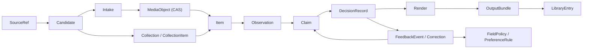
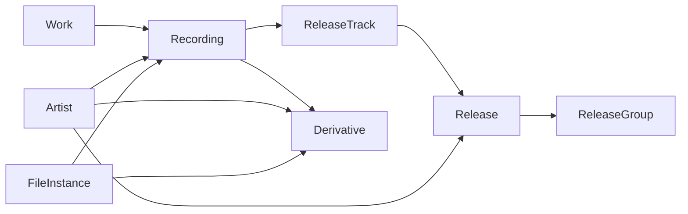

# 01. Доменная модель

> Статус: **черновик v0.3**. Опирается на решения Q1–Q31 и уточняет их.
> Цель документа — зафиксировать язык, сущности, инварианты и границы, чтобы код не превратился в «dataclass со всеми полями».

## 1. Зачем нужна отдельная доменная модель

В старой попытке (`gravidrome`) был один `AudioFileTextMetadata` со всеми возможными полями. Это удобно на старте, но быстро начинает врать:

- непонятно, откуда взялось значение;
- непонятно, это факт, догадка или выбор пользователя;
- нельзя хранить альтернативы;
- нельзя перезапустить интерпретацию, не потеряв предыдущую;
- нельзя отличить «название исходного трека» от «название nightcore-загрузки».

Доменная модель TrackForge разводит пять вещей, которые обычно смешивают:

```text
Content  →  Identity  →  Evidence  →  Decision  →  Output
(байты)     (что это)     (почему)     (что выбрали)  (что записали)
```

## 2. Принципы моделирования

1. **Явные идентификаторы и ссылки.** Сущности не вкладываются друг в друга «навсегда»; они ссылаются по ID. Это нужно для кэша, частичной загрузки и будущего GUI.
2. **Append-only там, где важна история.** Наблюдения, claims, feedback и решения не перезаписываются; новые версии добавляются рядом.
3. **Мутабельное состояние — только у исполнения.** `Run`, `Step`, `Item.status` могут меняться; доказательства и правки — нет.
4. **Никаких «магических» значений.** У каждого claim есть источник, метод, уверенность и доказательство. У каждого decision — альтернативы и причина.
5. **Типизированные значения.** Строка, число, дата, список, внешний ID и медиа-ссылка — разные типы; нельзя всё свести к `str | None`.
6. **Unknown — легальный результат.** Лучше честно оставить поле пустым и отправить в review, чем придумать значение.
7. **Домен не знает про I/O.** Ни `httpx`, ни `ffmpeg`, ни `mutagen`, ни SQLAlchemy в доменных модулях. Это работа портов и адаптеров.

## 3. Карта агрегатов



`Item` — агрегатный корень одной аудиоединицы. Он не хранит все артефакты внутри себя, а ссылается на них. Это позволяет перечитывать/пересобирать части независимо.

```text
Item:
  id
  media_id
  primary_intake_id
  collection_id?           # если пришёл из плейлиста/альбома/папки
  kind?                    # ContentKind, появляется после interpret
  status                   # discovered | acquired | observed | interpreted |
                           # resolved | rendered | published | needs_review |
                           # failed | duplicate | archived
  identity_hypotheses[]    # ссылки
  decision_record_id?
  render_ids[]
  created_at, updated_at
```

`SourceSnapshot` — неизменяемый снимок ответа источника (JSON, HTML, API response) с датой, версией адаптера и, если нужно, URL/заголовками. Он нужен как доказательство и для воспроизводимости парсеров.

## 4. Источники, коллекции и приобретение

### 4.1. `SourceRef`

Описывает входную точку:

- `LocalPath(path)`;
- `Url(url, site_hint?)`;
- `TextQuery(text, locale?)`;
- `CollectionRef(kind, source, external_id?)`.

`SourceRef` — это «откуда пришли», а не «что получили». Один и тот же URL может дать несколько кандидатов.

### 4.2. `Candidate`

Возможный вариант медиа, который источник предлагает до скачивания:

```text
Candidate:
  id
  source_ref
  external_id          # id на площадке
  title, uploader, duration
  formats[]            # codec, bitrate, sample_rate, language, size, url, drm
  thumbnails[]
  extra                # source-specific, не парсится доменом
```

`Candidate` не является треком. Это предложение пользователю/планировщику.

### 4.3. `Collection` и `CollectionItem`

`Collection` — плейлист, альбом, канал или локальная папка. У неё есть:

- `kind`: `playlist | album | channel | folder | other`;
- `source_ref`;
- `title`, `owner`, `description`;
- `context_claims[]` — метаданные, которые относятся ко всей коллекции (альбом, обложка, год, жанр, номер диска);
- `items[]` — упорядоченные `CollectionItem`.

`CollectionItem`:

```text
CollectionItem:
  position
  candidate
  item_id?             # появляется после acquire
  status               # planned | acquired | processed | skipped | failed
```

Важно: **коллекция — не трек**. Её метаданные — это контекст, который policy может использовать или игнорировать. Пользователь выбирает, тегировать «по плейлисту» или «по альбому автора».

`Collection(kind=album)` — это **входной контейнер** (альбомная страница/папка/плейлист), а `Release` — **идентифицированный музыкальный релиз**. Они могут ссылаться друг на друга, но не заменяют друг друга: у collection может не быть release, а release может быть найден независимо от того, как пришёл файл.

### 4.4. `Intake`

Один факт приобретения:

```text
Intake:
  id
  item_id
  source_ref
  candidate
  source_snapshot       # info.json, HTML, API response, дата и версия адаптера
  downloader            # id + version
  media_id              # ссылка на MediaObject
  created_at
  status                # succeeded | failed | cancelled
```

Зачем отдельно от `MediaObject`: одни и те же байты могут быть получены из разных источников. `MediaObject` — про содержимое, `Intake` — про происхождение. Это спасает от потери source-контекста при дедупликации.

### 4.5. `MediaObject`

```text
MediaObject:
  id                    # внутренний id
  content_hash          # sha256(bytes)
  size_bytes
  cas_path
  container             # mp3, m4a, flac, ogg, opus, wav...
  codec, bitrate, sample_rate, channels
  duration_seconds
  probe_artifact_id
  created_at
```

Инварианты:

- байты по `content_hash` неизменяемы;
- `content_hash` считается по исходным байтам, до любой перекодировки;
- `MediaObject` не хранит пользовательские теги — только измеренные свойства контейнера;
- `Acquire` по возможности берёт audio-only; если контейнер всё же содержит видео, извлечение аудио — производный артефакт, а не изменение `MediaObject`;
- существующие теги файла **не стираются** из исходника. Они читаются как `Observation` (`initial.tags.v1`) и участвуют в резолве как ещё один источник; исходный файл остаётся нетронутым.

### 4.6. `FileInstance`

Конкретное появление байтов на диске:

```text
FileInstance:
  id
  media_id
  path
  role                  # source | cas | render | library | duplicate
  size_bytes, mtime
  intake_id?
```

Нужен, чтобы:

- не путать «файл в папке пользователя» и «файл в библиотеке»;
- хранить дубликаты;
- понимать, что именно было изменено/удалено.

## 5. Идентичность

### 5.1. Зачем граф, а не строка

Строка `"Artist - Song (Nightcore)"` не отвечает на вопросы:

- это оригинальный трек или производная?
- кто автор оригинального трека?
- какой альбом считается «родным»?
- какой MBID у recording, а какой — у release?
- что писать в `artist`, если uploader — не артист?

Поэтому идентичность — это набор гипотез о сущностях и связях.

### 5.2. Сущности

| Сущность | Что описывает | Ключевые поля |
|---|---|---|
| `Work` | Композиция (слова + музыка) | title, composers, lyricists, ISWC |
| `Recording` | Конкретное исполнение/запись | title, artists, duration, ISRC, MBID |
| `Release` | Альбом/EP/сингл | title, release_group, date, label, catalog_number, barcode, country |
| `ReleaseTrack` | Позиция recording в release | release_id, recording_id, position, disc, title |
| `ReleaseGroup` | Группа релизов | title, primary_type, secondary_types |
| `Artist` | Исполнитель/автор | name, sort_name, MBID, aliases |
| `Derivative` | Производная версия recording | source_recording, transformations, parameters, derivative_artist, title |
| `FileInstance` | Байты на диске | media_id, path, role |

`Artist` в v1 может быть «лёгкой» сущностью: имя + опциональный MBID. Полный граф артистов (relationships, credits) — позже; не тащить его в MVP.

### 5.3. Связи



- `Recording` — исполнение `Work`.
- `ReleaseTrack` связывает `Release` и `Recording`, добавляет позицию/диск/название в релизе.
- `Derivative` ссылается на исходный `Recording` и хранит преобразования.
- `FileInstance` может инстанцировать `Recording` или `Derivative`; один файл может быть частью `Release`.

### 5.4. Производные версии

`Derivative` — это не «тип трека», а связь + преобразования:

```text
Derivative:
  id
  source_recording_id?
  transformations[]     # nightcore, sped_up, slowed, reverb, 8d, remix,
                        # bootleg, mashup, cover, instrumental, acapella,
                        # karaoke, radio_edit, extended, live, acoustic, demo
  parameters            # speed_factor, pitch_semitones, bpm_ratio, reverb_amount...
  derivative_title?
  derivative_artist?    # uploader/remixer, если известен
  is_official?          # official remix vs bootleg
  evidence[]
```

`ContentKind` — отдельная ось:

```text
ContentKind = music | audiobook | podcast | talk | sound_effect | other
```

Нельзя смешивать «это nightcore» и «это подкаст» в одном enum. У подкаста тоже может быть speed-up версия.

### 5.5. `IdentityHypothesis`

До принятия решения идентичность — это гипотезы:

```text
IdentityHypothesis:
  id
  item_id
  target_type           # recording | release | release_group | work | derivative
  target_id?            # если сущность уже известна
  external_ids          # MBID, ISRC, AcoustID и т.п.
  score                 # 0..1, калиброванный
  evidence[]            # ссылки на наблюдения/claims
  status                # proposed | accepted | rejected | ambiguous
```

Правила:

- гипотез может быть несколько;
- `ambiguous` — нормальное состояние, а не ошибка;
- нельзя «назначать» оригинал по умолчанию, если доказательств нет;
- MBID — сильный, но не обязательный якорь.

## 6. Доказательства

### 6.1. `Observation`

Сырой результат измерения или получения:

```text
Observation:
  id
  item_id
  type                  # audio.probe, audio.features, asr.transcript, source.metadata,
                        # musicbrainz.search, acoustid.lookup, cover.candidates...
  schema_version
  producer              # analyzer/provider id + version
  inputs[]              # artifact/media ids
  params                # нормализованные параметры
  payload               # типизированный JSON
  warnings[]
  created_at
  content_hash          # хэш самого артефакта
```

Свойства:

- immutable;
- новая версия анализатора создаёт новый `Observation`, а не перезаписывает старый;
- `payload` валидируется схемой;
- `warnings` обязательны для деградации (например, «ASR отключён», «MusicBrainz rate limit»).

### 6.2. `Claim`

Утверждение о значении поля:

```text
Claim:
  id
  item_id
  subject               # item | media | recording | release | release_group | work |
                        # artist | derivative | collection
  subject_id?
  field                 # title, artist, album, date, genre, bpm, key, lyrics, artwork...
  value                 # типизированное значение
  role?                 # main, featured, remixer, composer, lyricist, producer...
  order?                # для multi-value полей
  locale?               # ru, en, ...
  source                # source/provider id
  method                # analyzer id + version, prompt/model, endpoint
  confidence            # 0..1, калиброванная
  evidence[]            # Observation ids, URL, цитата
  derived_from[]        # Claim ids, если значение синтезировано
  status                # proposed | accepted | rejected | superseded
  notes?
  created_at
```

Ключевые решения:

- **Один claim — одно значение.** Для нескольких артистов/жанров создаются отдельные claims с `role`/`order`. Это проще, чем хранить список в одном значении и потом мержить.
- **`subject` обязателен.** `recording.title` и `derivative.title` — разные claims, даже если строки совпадают.
- **`confidence` — калиброванная.** Сырой score анализатора хранится в `Observation`; в claim попадает значение после калибровки. Нельзя сравнивать сырые score разных анализаторов напрямую.
- **`derived_from` обязателен для синтеза.** Если LLM собрал `"Song (Nightcore)"` из `"Song"` и `nightcore`, это видно.
- **Claims append-only.** `status` меняется событием, но исходный claim не удаляется.

### 6.3. `Provenance`

Минимальный набор:

- `source` — откуда (URL, API, локальный файл);
- `method` — чем (анализатор, версия, модель, промпт);
- `observed_at`;
- `cost` — CPU/токены/деньги, если известны;
- `evidence` — ссылки на артефакты/цитаты.

Без provenance claim не имеет права участвовать в автоматическом решении.

### 6.4. Уверенность

- `raw_score` — то, что вернул метод (similarity, probability, rank).
- `calibrated_confidence` — то, что попадёт в claim.
- Калибровка — per-method, по размеченному набору; для v1 можно использовать консервативные ручные коэффициенты, но с явной версией.
- LLM self-confidence **не** считается достаточным; усиливается:
  - наличием цитат;
  - согласием с другими claims;
  - валидацией схемы;
  - проверкой на противоречия.

### 6.5. Конфликты

Конфликт — это не «две строки не равны». Нужно различать:

- точное совпадение;
- нормализованное совпадение (регистр, пунктуация, `feat.`);
- совпадение после транслитерации;
- разные значения одного поля;
- разные роли (main vs featured);
- разные локали.

Политика резолва работает с нормализованными значениями, но сохраняет исходные.

## 7. Решения

### 7.1. Режимы

| Режим | Финальное значение | LLM | Запись в `DecisionRecord` |
|---|---|---|---|
| `policy` | Policy engine | Только как источник/арбитр по правилу | `decided_by=policy` |
| `llm_assisted` | Policy engine | Предлагает, policy валидирует | `decided_by=policy+llm` |
| `llm_autopilot` | LLM | Выбирает/синтезирует | `decided_by=llm` |
| `manual` | Пользователь | Подсказки | `decided_by=user` |

### 7.2. `FieldPolicy`

```text
FieldPolicy:
  id
  field
  scope                 # global | profile | source | artist | item
  conditions[]          # kind=nightcore, source=youtube, confidence>0.8...
  strategy              # source_priority | authority | consensus |
                        # llm_adjudicate | ranker_adjudicate | user_lock |
                        # derive | keep_existing | review
  priority[]            # упорядоченные источники/методы
  validators[]          # непустая строка, допустимый язык, формат MBID...
  on_missing            # unknown | review | fail
  version
```

Стратегии v1:

- `source_priority` — явный порядок источников;
- `authority` — сильный внешний ID (MusicBrainz/AcoustID) важнее;
- `consensus` — совпадение нескольких независимых источников;
- `llm_adjudicate` — LLM выбирает из claims с объяснением;
- `ranker_adjudicate` — не-генеративная модель/ранкер выбирает из конечного набора claims; дешёвый fallback без сети;
- `user_lock` — пользователь зафиксировал значение;
- `derive` — значение собирается из других полей (например, `Title (Nightcore)`);
- `keep_existing` — сохранить текущий тег, если он валиден;
- `review` — всегда отдать человеку.

### 7.3. `Decision`

```text
Decision:
  field
  subject
  value                 # финальное значение или None
  chosen_claim_id?
  alternatives[]        # Claim ids, включая отклонённые
  derived_from[]        # Claim ids, если значение синтезировано
  policy_id
  mode
  decided_by            # policy | policy+ranker | policy+llm | llm | user | hybrid
  confidence
  rationale             # человекочитаемое объяснение
  locked                # пользователь зафиксировал
  created_at
```

`Decision` — не просто «победивший claim». Это результат применения политики, который может:

- выбрать claim;
- синтезировать значение;
- оставить `unknown`;
- отправить в review;
- сохранить пользовательский lock.

### 7.4. `DecisionRecord`

Снимок всех решений по item:

```text
DecisionRecord:
  id
  item_id
  version
  decisions[]
  policy_versions[]
  llm_model?
  prompt_version?
  input_claim_ids[]
  created_at
```

Снимок нужен для:

- воспроизводимости;
- объяснения пользователю;
- сравнения с feedback;
- повторного render без повторного resolve.

### 7.5. Locks и overrides

- Lock ставится на поле (`title`, `artist`, ...) или на item целиком.
- Lock всегда сильнее policy и LLM.
- Lock хранится отдельно от claim: это не «ещё один источник», а правило «не менять».
- Пользовательское значение хранится как claim с `source=user`, `method=manual_override`, `confidence=1.0`.
- При повторном resolve lock применяется первым; остальные claims всё равно сохраняются для аудита.

### 7.6. Guardrails для `llm_autopilot`

Даже в autopilot:

1. LLM получает только claims/наблюдения, а не «право писать в файл».
2. Ответ валидируется схемой; неизвестные поля запрещены.
3. Каждое значение должно ссылаться на claim IDs или `derived_from`.
4. LLM не может создать MBID/ISRC/URL, которых нет в claims; только выбрать существующий.
5. Пользовательские locks проверяются после LLM и всегда побеждают.
6. Жёсткие валидаторы полей (длина, язык, допустимые символы, формат ID) применяются до записи.
7. Если ответ невалиден/противоречив — fallback в `policy` или review; это фиксируется.
8. Стоимость и модель пишутся в `DecisionRecord`.

### 7.7. Ranker и выбор из конечного набора

Не все задачи требуют генерации текста. Для выбора между готовыми claims часто достаточно **ranker'а** — модели, которая оценивает пары «запрос/кандидат» и возвращает порядок, но ничего не сочиняет.

```text
ClaimRanker:
  id
  version
  model_id?
  max_candidates
  cost                  # cpu_seconds, memory_mb
  kind                  # lexical | embedding | cross_encoder | llm_choice

  rank(query, candidates) -> list[ScoredCandidate]
```

Примеры:

- лексический baseline на `rapidfuzz`/нормализации;
- embedding-сходство (Sentence Transformers, CPU/ONNX);
- cross-encoder reranker (маленькая модель, CPU/ONNX);
- LLM с ограниченным выбором (constrained choice), если он доступен.

Правила:

- ranker не создаёт новые значения; он только упорядочивает существующие claims;
- его score калибруется и хранится как evidence, а не как «истина»;
- он используется, когда облачная LLM недоступна, дорога или политика запрещает генерацию;
- решение всё равно проходит через `FieldPolicy` и валидаторы;
- в `DecisionRecord` фиксируются `ranker_id`, `model_version`, `candidates`, `scores`.

### 7.8. `unknown` — это решение

Если ни один claim не проходит порог, `Decision.value = None`, `status=unknown`. Это лучше, чем угадывать. `unknown` может:

- остаться пустым в тегах;
- попасть в review;
- быть заполненным пользователем позже.

## 8. Обратная связь

### 8.1. Типы событий

| Событие | Когда возникает | Влияет на текущий резолв? |
|---|---|---|
| `Correction` | Пользователь изменил решение/значение | Да, как claim + lock (по выбору) |
| `Approval` | Пользователь подтвердил решение | Нет, но повышает доверие |
| `Rejection` | Пользователь отклонил кандидата/значение | Нет, но useful как сигнал |
| `Lock` / `Unlock` | Пользователь зафиксировал/снял поле | Да |
| `ReviewNote` | Комментарий без изменения | Нет |
| `ExternalEdit` | Теги выходного файла изменились вне TrackForge | Да, после подтверждения |

В MVP включён только `Correction` по явным правкам (плюс `Lock`/`Unlock` и заметки review). `ExternalEdit` и неявные сигналы заложены в модель, но не реализуются до следующего среза.

### 8.2. `Correction`

```text
Correction:
  id
  item_id
  field
  system_decision_id
  system_value
  user_value
  user_claim_id?
  scope                 # item | field | source | artist | profile | global
  reason_code           # wrong_title | wrong_artist | wrong_album | wrong_cover |
                        # wrong_type | wrong_lyrics | wrong_date | other
  reason_text?
  context_snapshot      # claims, alternatives, source snippets, versions
  created_at
  applied               # было ли применение к output
```

`context_snapshot` — важно. Он позволяет анализировать ошибку даже если исходные артефакты удалены или анализатор обновился. Это JSON-снимок, а не ссылка на живой файл.

Общий формат события:

```text
FeedbackEvent:
  id
  kind                  # correction | approval | rejection | lock | unlock |
                        # review_note | external_edit
  item_id
  field?
  system_value?
  user_value?
  scope?
  reason?
  context_snapshot?
  created_at
```

`Correction` — специализация `FeedbackEvent` с обязательными `system_value`, `user_value` и `reason_code`. Остальные события могут быть легче.

### 8.3. `PreferenceRule` (позже, но закладываем)

```text
PreferenceRule:
  id
  scope                 # source | artist | profile | global
  condition             # например, source=youtube и field=title
  action                # например, не использовать title, если есть MB
  source_correction_ids[]
  enabled
  version
```

Правило создаётся **только явно** пользователем (или полуавтоматически с подтверждением). Оно не является «магически обученной моделью»; его можно прочитать, выключить и откатить.

### 8.4. Scope

- `item` (default) — правка только для этого item/поля;
- `source` — правило для источника (например, «не брать title из YouTube, если есть MusicBrainz»);
- `artist` — правило для артиста;
- `profile` — для профиля;
- `global` — для всех.

`item` — это correction/lock; `source`/`artist`/`profile`/`global` — это `PreferenceRule` (future), а не per-item lock. Повышение scope — **явное действие пользователя**. Автоматическое обобщение в v1 запрещено.

### 8.5. `ReviewSession`

```text
ReviewSession:
  id
  item_ids[]
  fields[]
  started_at
  finished_at?
  corrections[]
  notes[]
```

Нужен, чтобы понимать контекст правок: пользователь правил один трек или пакет; какие поля смотрел; сколько времени потратил.

### 8.6. Экспорт и использование

- `feedback.jsonl` — append-only, одна строка = одно событие.
- `trackforge feedback export` — JSONL/CSV для анализа.
- `trackforge feedback stats` — correction rate по полям/источникам/моделям.
- Evaluation harness сравнивает `DecisionRecord` с `Correction.user_value`.
- Изменения политик/промптов — только после прогона на holdout-наборе, а не «потому что одна правка».
- В v1 нет автоматического обучения модели; есть накопление данных и ручная/полуавтоматическая калибровка.

### 8.7. Приватность

- журнал локальный по умолчанию;
- контекст может содержать текст/описание/названия — не отправлять в облако без opt-in;
- экспорт для LLM-анализа — только с redaction/согласием;
- пользователь может удалить item и связанные feedback, если это явно разрешено (но это ломает историю; предупреждать).

## 9. Возможности и исполнение

### 9.1. `ArtifactType`

Тип артефакта с версией схемы:

```text
ArtifactType:
  namespace             # audio, source, identity, lyrics, cover, llm...
  name                  # probe, features, transcript, metadata, search...
  schema_version
```

Примеры: `audio.probe.v1`, `audio.features.v1`, `asr.transcript.v1`, `source.metadata.v1`, `musicbrainz.search.v1`.

### 9.2. `CapabilityManifest`

```text
CapabilityManifest:
  id
  version
  kind                  # observer | interpreter | provider | ranker | renderer
  requires[]            # ArtifactType / field
  provides[]            # ArtifactType / field
  cost                  # cpu_seconds, memory_mb, network_calls, money_usd
  determinism           # deterministic | seeded | non_deterministic
  cacheable
  config_schema
  description
```

Это контракт, по которому планировщик строит DAG и проверяет совместимость.

### 9.3. `ProviderChain` и `AnalysisProfile`

```text
ProviderChain:
  artifact_type
  providers[]           # ordered, with conditions and fallback
  on_empty              # fail | degrade | review

AnalysisProfile:
  name                  # fast | balanced | full | custom
  enabled[] / disabled[]
  budget                # max_cpu_seconds, max_network_calls, max_cost
  quality_target
  fallback_policy
  selection_strategy    # llm | ranker | lexical | hybrid
```

Пример цепочки:

```text
lyrics:
  lrclib -> genius -> asr
cover:
  cover_art_archive -> itunes -> deezer -> source_thumbnail
identity:
  acoustid -> musicbrainz_search -> ranker -> llm_hypothesis
```

### 9.4. `Run`, `Step`, `Artifact`

```text
Run:
  id, item_ids[], profile, mode, status, started_at, finished_at, error?

Step:
  id, run_id, item_id, capability_id, status, attempts, started_at,
  finished_at, cache_key, error?, warnings[]

Artifact:
  id, type, schema_version, producer, inputs[], params, payload_ref,
  content_hash, created_at
```

Состояния:

- `Run`: `planned → running → paused → completed | failed | cancelled`;
- `Step`: `pending → ready → running → succeeded | failed | skipped | cached`;
- `Item`: `discovered → acquired → observed → interpreted → resolved → rendered → published`, с ветками `needs_review`, `failed`, `duplicate`, `archived`.

### 9.5. Ключ кэша

```text
cache_key = hash(
  input_artifact_hashes[] +
  capability_id + capability_version +
  normalized_params +
  relevant_config +
  model_id + model_version + prompt_version
)
```

`relevant_config` — только то, что реально влияет на шаг. Нельзя включать весь конфиг: иначе любой unrelated change инвалидирует всё.

### 9.6. Деградация

- `required` output: успешно созданный выходной файл. Его отсутствие — ошибка (`failed`).
- `desired` outputs: title, artist. Если доказательств нет — `unknown`, а не fail; имя файла собирается по резервному шаблону.
- `optional` outputs: bpm, key, genre, lyrics, cover, mood, language...
- Если optional не получен — `degraded` + warning; в `Decision` поле `unknown`.
- Fallback-цепочки могут включать 0.5B local (classification/ranking), `ClaimRanker` (выбор из конечного набора) и упрощённые версии анализаторов.
- Отключённый анализатор — это `skipped` с причиной, а не «пустой результат».
- Любая деградация видима в отчёте и `DecisionRecord`.

## 10. Выход

```text
ResolvedMetadata:
  item_id
  decision_record_id
  fields                  # canonical field -> value(s)
  unknowns[]
  warnings[]

Render:
  id
  item_id
  decision_record_id
  target_format
  naming_template
  tag_mapping_version
  options                 # embed cover, lyrics sidecar, transcode...
  status

OutputBundle:
  id
  render_id
  files[]                 # audio, cover, lyrics, sidecar
  bundle_hash
  created_at

LibraryEntry:
  id
  item_id
  bundle_id
  path
  status                  # published | missing | modified | duplicate
  published_at
```

`Render` — план/операция; `OutputBundle` — фактические файлы; `LibraryEntry` — то, что опубликовано и учтено.

Sidecar `trackforge.json`:

- `schema_version`;
- `content_hash`;
- `decision_record_id` / `decision_version`;
- canonical metadata;
- source refs;
- render options;
- warnings/unknowns.

Sidecar не заменяет БД, но позволяет восстановить контекст и продолжить без неё.

## 11. Инварианты

1. `MediaObject.content_hash` — SHA-256 исходных байтов; байты неизменяемы.
2. Оригинальные/source-файлы не модифицируются.
3. `Observation` immutable; новая версия — новый артефакт.
4. `Claim` append-only; статус меняется событием, не удалением.
5. У каждого claim есть provenance и evidence (или явная причина, почему evidence — только source snapshot).
6. У каждого decision есть альтернативы и rationale; `locked` сильнее policy/LLM.
7. Ни один анализатор не пишет выходные файлы; это делают только renderer/publisher.
8. `Collection` не является `Recording`; контекст коллекции — отдельные claims.
9. Ключ кэша включает версии capability/model/prompt и релевантные параметры.
10. Пользовательские corrections никогда не удаляются молча.
11. `unknown` — валидное решение; запрещено подставлять выдуманное значение.
12. Синтезированное значение обязано иметь `derived_from`.
13. Внешние ID (MBID/ISRC) нельзя выдумывать; их можно только выбрать из claims.
14. Пути выхода санитизируются; никакого path traversal.
15. Sidecar ссылается на `content_hash` и версию decision; этого достаточно для базового resume.

## 12. Пример: nightcore-ссылка с YouTube

1. **Plan.** `YtDlpSource.supports(url)` → true. Источник возвращает `Candidate` (форматы, duration, title, uploader, thumbnails). Пользователь выбирает лучший аудиоформат.
2. **Acquire.** `Intake` + `MediaObject` в CAS + `SourceSnapshot` (`info.json`). `ffprobe` → `audio.probe.v1`.
3. **Observe.**
   - `source.metadata.v1`: title, uploader, description, tags, upload_date;
   - `initial.tags.v1`: теги, если они были;
   - `acoustid.lookup.v1`: fingerprint → возможные recordings;
   - `musicbrainz.search.v1`: кандидаты;
   - `audio.features.v1`: BPM, key, duration, spectral;
   - `cover.candidates.v1`: CAA/iTunes/Deezer/thumbnail;
   - `asr.transcript.v1`: если включён;
   - `audio.stems.v1`: если включён Demucs.
4. **Interpret.**
   - `kind = music`;
   - `derivative = nightcore` по метаданным/темпу/описанию;
   - `IdentityHypothesis`: source recording = MusicBrainz recording X (score 0.86), derivative = nightcore upload (score 0.92).
5. **Claims.**
   - `recording.title = "Song"` (MusicBrainz, 0.95);
   - `derivative.title = "Song (Nightcore)"` (YouTube, 0.90);
   - `file.title = "song_nightcore_final"` (existing tag, 0.20);
   - `recording.artist = "Artist"` (MusicBrainz, 0.95);
   - `derivative.uploader = "NightcoreChannel"` (YouTube, 0.99);
   - `release.title = "Album"` (MusicBrainz, 0.90);
   - `collection.title = "Nightcore Mix"` (playlist, 0.80).
6. **Resolve.**
   - `title = "Song (Nightcore)"` — derived from `recording.title` + transformation;
   - `artist = "Artist"` — authority;
   - `album = "Album"` — album-first policy; альтернатива — playlist;
   - `cover = CAA front` — authority/quality;
   - `bpm = 172` — acoustic;
   - `genre = "Nightcore"` — derivative tag + genre policy.
7. **Render.** `Artist - Song (Nightcore).m4a`; теги; cover; LRC (если есть); sidecar.
8. **Publish.** Копия в managed library; `LibraryEntry`; отчёт.
9. **Feedback.** Пользователь меняет `artist` на `"Artist feat. X"`. Создаётся `Correction` с `scope=item`, `system_value="Artist"`, `user_value="Artist feat. X"`, `context_snapshot` (все claims и версии). Если пользователь ставит lock — поле больше не меняется при re-resolve.

## 13. Открытые вопросы домена

- Q19–Q28 закрыты: явные corrections, item-level + явное повышение, autopilot с `derived_from`, деградация с `unknown`/ranker/локальной LLM, GPL-3.0-or-later, форматы MP3/M4A/FLAC/OGG/Opus, гибридный ranker, источники `yt-dlp` + API + plugins, шаблон `{artist} - {title} ({qualifier})`.
- **Насколько глубоко моделировать MusicBrainz-граф в v1?** Предложение: `Recording`/`Release`/`Artist` + MBID, без полного credit/relationship-графа; relationships добавляем по мере необходимости.
- **Мультиязычные названия.** Предложение: хранить claims с `locale`, в output выбирать locale по профилю; альтернативные названия — в sidecar.
- **Артист — сущность или строка?** Предложение: лёгкая `Artist` с именем + опциональным MBID; строковые claims допустимы, но при наличии MBID связываем.
- **Один item на файл или на recording?** Предложение: item на контент/файл; дубликаты связываются через `MediaObject`/`FileInstance`, а не сливаются автоматически.
- **Плейлист vs альбом.** Предложение: `Collection` для обоих; policy выбирает, какие context claims использовать.
- **Аудиокниги/подкасты.** `ContentKind` + главы; отдельная глубокая модель — позже.
- **Размер `context_snapshot`.** Нужен баланс между полнотой и приватностью/размером; хранить claims + цитаты, не всё аудио.
- **Хранить ли пользовательскую правку как claim и как feedback?** Предложение: да, оба; claim нужен для текущего резолва, feedback — для обучения/аудита.
- **Какой cross-encoder брать?** Позже, после CPU-бенчмарка; критерии — multilingual, лицензия, размер, ONNX-совместимость. Порт `ClaimRanker` уже зафиксирован, модель заменяема.
