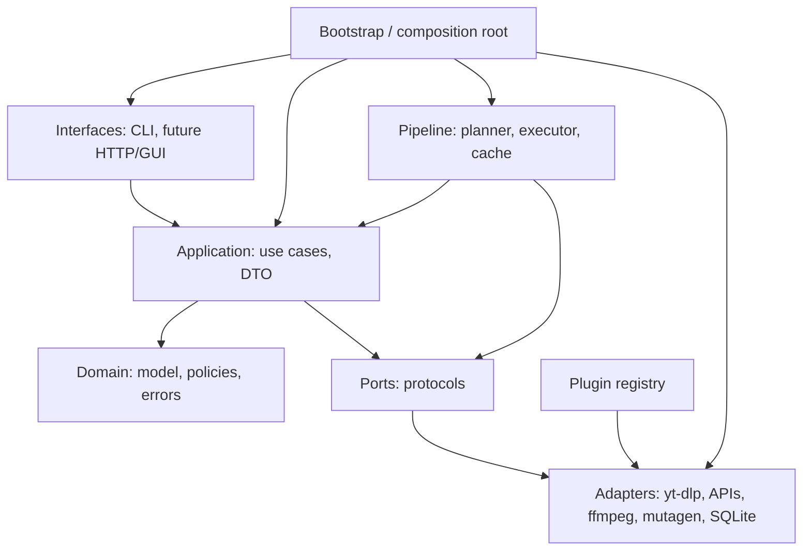

# 02. Архитектура

> Статус: **черновик v0.3**. Опирается на решения Q1–Q28.
> Цель — зафиксировать слои, границы, порты, публичный API и правила, по которым можно писать код без «архитектуры на салфетке».

## 1. Цели и ограничения

| Ограничение | Следствие |
|---|---|
| Личный локальный инструмент, один пользователь | Без auth, мультитенантности, серверной БД и очередей |
| Linux-first, CPU-only | Пути/бинарники/модели проверяем на Linux; тяжёлые модели — опциональные профили |
| Целевой масштаб: Linux-only v1, 1k–10k треков, плейлисты до 500 | SQLite/индексы с запасом; очередь с паузами/resume; Windows/macOS позже |
| Python 3.12+, `uv`, `pyproject.toml` | Современный toolchain, воспроизводимые окружения |
| CLI + Python API сейчас, GUI позже | Вся логика — в application services; CLI/GUI — тонкие клиенты |
| MVP — один трек (файл или ссылка) | Никаких плейлистов/пакетной обработки в первом срезе |
| Managed library | Оригиналы не трогаем; output — производные файлы + sidecar |
| Evidence-driven | Домен вращается вокруг claims/decisions, а не одного dataclass с тегами |
| Расширяемость | Порты/адаптеры + capability-манифесты + plugin registry |
| GPL-3.0-or-later | License boundary: ядро не импортирует GPL/AGPL-библиотеки |

## 2. Архитектурный стиль

**Модульный монолит + гексагональная архитектура + DAG-пайплайн.**

- Один процесс, один репозиторий, чёткие модули.
- Домен не знает про I/O.
- Application-сценарии оркестрируют порты.
- Адаптеры реализуют порты и подключаются в composition root.
- Пайплайн — это планировщик/исполнитель DAG поверх application-сервисов.
- Плагины — те же адаптеры, но с манифестами и entry points.

### 2.1. Почему не микросервисы

Для одного пользователя и локальной библиотеки микросервисы дают:

- сетевые ошибки там, где их не должно быть;
- сложный деплой;
- распределённые транзакции;
- дублирование моделей/кэшей.

Границы модулей важнее границ процессов. Если позже понадобится GUI-сервер, он запускается как отдельный процесс поверх тех же application services, без переписывания домена.

### 2.2. Почему не Celery/Redis/Prefect

- Внешняя инфраструктура не нужна одному пользователю.
- SQLite + файловые артефакты достаточно надёжны для локального pipeline.
- Собственный executor проще отлаживать и контролировать (resume, бюджет, деградация).
- Если когда-нибудь понадобится распределённость, `StepExecutor` можно заменить, не меняя домен.

### 2.3. Почему не полный event sourcing

- Слишком дорого для v1.
- Append-only нужен только для доказательств, claims, feedback и решений.
- Состояние `Run`/`Step`/`Item` можно хранить мутабельно в SQLite.
- Это гибрид: audit-log для важного, обычное состояние для исполнения.

## 3. Правило зависимостей



Правила:

1. `domain` импортирует только stdlib/typing; никаких `httpx`, `ffmpeg`, `mutagen`, SQLAlchemy, pydantic-моделей БД.
2. `application` импортирует `domain` + `ports`; не импортирует адаптеры.
3. `adapters` реализуют `ports`; один адаптер не импортирует другой адаптер.
4. `pipeline` импортирует `application`/`ports`; не знает конкретных адаптеров.
5. `interfaces` импортируют только публичный API/DTO; не лезут в домен напрямую.
6. `bootstrap` — единственное место, где собираются конкретные реализации.
7. Плагины регистрируются в `bootstrap`/`plugins`; ядро не делает `import` конкретного плагина.

Проверка: `import-linter` (или аналогичный контрактный тест) в CI. Это дешёвый способ не дать слоям «попротекать».

## 4. Структура пакета

```text
src/trackforge/
  domain/
    model/
      ids.py                 # ItemId, ClaimId, DecisionId, ...
      item.py                # Item, ItemStatus
      source.py              # SourceRef, Candidate, SourceSnapshot
      collection.py          # Collection, CollectionItem
      media.py               # MediaObject, FileInstance, Intake
      identity.py            # Work, Recording, Release, ReleaseGroup, Artist,
                             # Derivative, IdentityHypothesis
      claims.py              # Observation, Claim, Provenance, Confidence
      decisions.py           # FieldPolicy, Decision, DecisionRecord, DecisionMode
      feedback.py            # FeedbackEvent, Correction, ReviewSession, PreferenceRule
      capabilities.py        # ArtifactType, CapabilityManifest, ProviderChain,
                             # AnalysisProfile
      outputs.py             # ResolvedMetadata, Render, OutputBundle, LibraryEntry
    policies/
      normalization.py       # нормализация строк/дат/артистов
      strategies.py          # source_priority, authority, consensus, ranker, llm...
      validators.py          # валидаторы полей
    errors.py
  application/
    ports/
      sources.py             # SourceResolver
      acquisition.py         # Acquirer / Downloader
      observations.py        # Probe, Observer
      metadata.py            # MetadataProvider
      interpretation.py      # Interpreter
      ranking.py             # ClaimRanker
      llm.py                 # LLMProvider
      rendering.py           # Renderer, TagReader, TagWriter
      publishing.py          # Publisher
      storage.py             # ArtifactStore
      repositories.py        # ItemRepository, RunRepository, FeedbackRepository...
      events.py              # EventBus
      models.py              # ModelManager
      rate_limit.py          # RateLimiter
      secrets.py             # SecretStore
      clock.py               # Clock, IdGenerator
    use_cases/
      plan_item.py
      acquire_item.py
      observe_item.py
      interpret_item.py
      resolve_item.py
      render_item.py
      publish_item.py
      process_item.py        # оркестрация полного пути
      review_item.py
      import_path.py
      export_feedback.py
      doctor.py
    dto/
      plan.py, results.py, views.py, errors.py
  pipeline/
    dag.py                   # Node/Edge/Graph
    planner.py               # desired outputs -> DAG
    executor.py              # topological execution, retries, cancellation
    cache.py                 # cache key, artifact lookup
    budget.py                # CPU/network/money budget
    degradation.py           # required/desired/optional, statuses
    jobs.py                  # run/step state machine
    events.py                # progress events
  adapters/
    sources/
      ytdlp/                 # subprocess adapter, cookies, playlists
    metadata/
      musicbrainz/
      acoustid/
      coverart/
      lrclib/
      deezer/
      itunes/
    analysis/
      ffprobe/
      librosa/
      whisper/
      demucs/
      essentia/              # optional, AGPL
      llm/                   # OpenAI-compatible / Ollama
      ranker/                # lexical / cross-encoder / 0.5B fallback choice
    persistence/
      sqlite/                # repositories, migrations
      filesystem/            # CAS, artifacts, sidecar
    tagging/
      mutagen/               # GPL-compatible adapter
    http/                    # httpx client factory, retries, rate limiting
  interfaces/
    cli/
      main.py
      commands/
      presenters/
  plugins/
    manifest.py
    registry.py
    discovery.py
  config/
    settings.py
    profiles.py
    secrets.py
  bootstrap/
    container.py
    logging.py
    doctor.py
```

Это **целевая** структура, а не требование создать все файлы сразу. В MVP будут только нужные модули; пустые «на будущее» не создаём.

## 5. Порты

Порты — `Protocol`/ABC в application-слое. Сигнатуры ниже концептуальные; детали — в `03-pipeline.md` и `09-interfaces.md`.

| Порт | Ответственность | Основные методы | Кто реализует |
|---|---|---|---|
| `SourceResolver` | Понять, поддерживает ли источник ссылку/путь; вернуть кандидатов/коллекцию | `supports(ref)`, `resolve(ref)` | `YtDlpSource`, `LocalFileSource`, future site plugins |
| `Acquirer` | Получить байты выбранного кандидата | `acquire(candidate, opts) -> IntakeResult` | `YtDlpAcquirer`, `LocalCopyAcquirer` |
| `MediaProbe` | Измерить контейнер/потоки | `probe(media) -> Observation` | `FfprobeProbe` |
| `Observer` | Получить наблюдение (локальное или сетевое) | `observe(ctx) -> Observation` | `LibrosaObserver`, `AcoustIdObserver`, `MusicBrainzObserver`, ... |
| `MetadataProvider` | Найти/получить внешние метаданные | `search(query)`, `lookup(id)` | MusicBrainz, Deezer, iTunes, ... |
| `Interpreter` | Превратить наблюдения в claims/гипотезы | `interpret(ctx) -> list[Claim]` | `KindClassifier`, `DerivativeDetector`, `LlmInterpreter` |
| `ClaimRanker` | Упорядочить готовые claims | `rank(query, candidates)` | `LexicalRanker`, `CrossEncoderRanker`, `LocalLlmRanker` |
| `LLMProvider` | Структурированный текстовый вызов | `complete(request) -> LLMResponse` | OpenAI-compatible, Ollama |
| `Renderer` | Собрать output bundle | `render(decisions, media, opts)` | `FfmpegRenderer`, `MutagenRenderer` |
| `TagReader` / `TagWriter` | Читать/писать теги, проверять | `read`, `write`, `verify` | `MutagenTagWriter` |
| `Publisher` | Атомарно опубликовать bundle | `publish(bundle) -> LibraryEntry` | `FileSystemPublisher` |
| `ArtifactStore` | CAS + артефакты | `put`, `get`, `has`, `open` | `FileSystemArtifactStore` |
| `ItemRepository` | Состояние item | `get`, `save`, `find_by_hash` | `SqliteItemRepository` |
| `RunRepository` | Run/Step | `create`, `update`, `list` | `SqliteRunRepository` |
| `FeedbackRepository` | Correction/события | `append`, `list`, `export` | `SqliteFeedbackRepository` |
| `RateLimiter` | Лимиты по хостам | `acquire(host)` | `PyrateLimiterAdapter` |
| `ModelManager` | Ленивая загрузка моделей | `get(model_id)`, `preload`, `unload` | `LocalModelManager` |
| `SecretStore` | Секреты | `get(key)` | Env/Keyring/CookieStore |
| `Clock` / `IdGenerator` | Время/ID | `now`, `new_id` | System |
| `EventBus` | Прогресс/события | `publish`, `subscribe` | In-process |
| `PluginRegistry` | Обнаружение/валидация плагинов | `discover`, `get`, `list` | `EntryPointPluginRegistry` |

### 5.1. Async vs sync

- Application services — **async-first**: сеть, LLM, файловые операции, ожидание моделей.
- CPU-bound анализ (librosa, Whisper, Demucs, cross-encoder) уходит в **process pool**; async-обёртка ждёт результат.
- Публичный API:
  - `AsyncTrackForge` — async-фасад для встраивания, CLI и будущего HTTP/GUI;
  - `TrackForge` — sync-фасад для простых скриптов; внутри аккуратно запускает event loop и явно падает, если вызван из уже работающего loop.
- CLI использует `AsyncTrackForge` (нужен прогресс/отмена); простые пользовательские скрипты — `TrackForge`.

Это даёт гибкость библиотеке и не заставляет CLI быть синхронным.

## 6. Application use cases

| Use case | Вход | Выход | Идемпотентность |
|---|---|---|---|
| `PlanItem` | `SourceRef`, профиль | `Plan` (кандидаты, DAG, оценки стоимости) | План не имеет side effects; кэш по source+config |
| `AcquireItem` | `Candidate`, опции | `Intake`, `MediaObject` | По source id + формату; повторный acquire возвращает существующий |
| `ObserveItem` | `MediaObject`, профиль | `Observation[]` | По media hash + observer/version/params |
| `InterpretItem` | `Observation[]` | `Claim[]`, `IdentityHypothesis[]` | По хэшам наблюдений + interpreter/version/prompt |
| `ResolveItem` | claims, политики, locks, режим | `DecisionRecord` | По claims + policy version + overrides |
| `RenderItem` | decisions, media, target format | `OutputBundle` | По decisions + renderer/version + options |
| `PublishItem` | bundle, library root | `LibraryEntry` | По bundle hash + target path |
| `ProcessItem` | source, opts | `RunResult` | Оркестрирует шаги; resume на любом шаге |
| `ReviewItem` | item, corrections | `Correction[]`, обновлённые decisions | Append-only feedback |
| `ImportPath` | путь/папка | item(s) / collection | По content hash; папка → `Collection` |
| `ExportFeedback` | фильтры | JSONL/CSV | Read-only |
| `Doctor` | конфиг | отчёт о зависимостях/моделях/правах | Read-only |

`ProcessItem` не должен быть «монолитом, который вызывает всё». Он вызывает те же use cases по очереди и умеет останавливаться/возобновляться.

## 7. Публичный Python API

### 7.1. Принципы

- Публичный API — это `trackforge.api` + DTO, а не внутренние доменные классы.
- DTO read-only; пользователь не может случайно поменять состояние.
- Ошибки — типизированные, с категорией (retryable/user-actionable).
- Внутренние модули можно менять; публичные — через deprecation.
- CLI не содержит бизнес-логики; он вызывает те же use cases.

### 7.2. Эскиз

Sync-фасад для простых скриптов:

```python
from trackforge import TrackForge, TrackForgeConfig, RunOptions

tf = TrackForge(TrackForgeConfig.from_file("config.toml"))

plan = tf.plan("https://www.youtube.com/watch?v=...")
result = tf.run(plan, RunOptions(mode="policy", profile="balanced"))

for item in result.items:
    print(item.status, item.output_path, item.warnings)
```

Async-фасад для CLI/встраивания:

```python
from trackforge import AsyncTrackForge, TrackForgeConfig, RunOptions

async with AsyncTrackForge(TrackForgeConfig.from_file("config.toml")) as tf:
    plan = await tf.plan("https://www.youtube.com/watch?v=...")
    result = await tf.run(plan, RunOptions(mode="policy", profile="balanced"))
```

`TrackForge` не пытается «магически» работать внутри уже запущенного event loop: он явно сообщает, что нужно использовать `AsyncTrackForge`. Это лучше, чем скрытые deadlock'и.

### 7.3. DTO (минимум)

- `PlanView`: source, candidates, collection?, estimated_cost, warnings.
- `RunResult`: run_id, status, items[], warnings[], errors[].
- `ItemView`: id, status, identity summary, decisions summary, output path, warnings.
- `DecisionView`: field, value, alternatives, confidence, rationale, locked.
- `CorrectionView`: field, system_value, user_value, scope, created_at.
- `DoctorReport`: checks[].

### 7.4. Ошибки

```text
TrackForgeError
├─ ConfigError
├─ UnsupportedSource
├─ CandidateNotFound
├─ AcquisitionFailed
├─ ProviderUnavailable
├─ RateLimited
├─ ResolutionFailed
├─ RenderFailed
├─ PublishFailed
└─ PluginError
```

У ошибок есть `retryable: bool`, `user_action: str | None`, `context: dict`.

## 8. CLI

CLI — тонкий presentational layer. Команды:

```text
trackforge add <url|path>        # plan + run, интерактивный выбор
trackforge plan <source>         # dry-run, показать кандидатов/план
trackforge import <path>         # локальный файл/папка
trackforge analyze <item>        # observe + interpret
trackforge resolve <item>        # policy / llm_assisted / llm_autopilot
trackforge render <item>         # собрать output
trackforge review <item>         # diff, правки, locks
trackforge feedback export       # JSONL/CSV
trackforge feedback stats        # correction rate
trackforge library scan|verify   # проверка библиотеки
trackforge config show|validate  # конфиг
trackforge doctor                # зависимости/модели/права
trackforge plugins list          # плагины
trackforge models list|download  # модели
```

Принципы:

- `--json` для машинного вывода.
- `--dry-run` для опасных операций.
- `--profile`, `--mode`, `--force`, `--offline`.
- Прогресс через `rich`; ошибки — в stderr.
- Exit codes: 0 — успех, 2 — user error, 3 — provider/network, 4 — partial/degraded, 5 — internal.

## 9. Plugin-архитектура

### 9.1. Манифест

Плагин объявляет:

```text
id, version, contract_version
kind: source | acquirer | observer | metadata | interpreter | ranker |
      renderer | tag_writer | publisher | llm
requires[], provides[]
cost, determinism, cacheable
config_schema
license
```

### 9.2. Обнаружение

- Встроенные адаптеры регистрируются в `bootstrap` как обычные плагины.
- Внешние — через entry points:
  - `trackforge.sources`
  - `trackforge.acquirers`
  - `trackforge.observers`
  - `trackforge.metadata`
  - `trackforge.interpreters`
  - `trackforge.rankers`
  - `trackforge.llm`
  - `trackforge.renderers`
  - `trackforge.tag_writers`
- Порядок: built-in → entry points → (позже) local plugin dir.
- Ошибка загрузки одного плагина не роняет ядро; она видна в `doctor`/логах.

### 9.3. Версионирование

- `contract_version` для API порта.
- Несовместимый плагин не загружается; понятная ошибка.
- `manifest.version` — версия плагина; `contract_version` — версия контракта.
- Ломающие изменения контракта → новая major-версия.

### 9.4. Доверие

- Плагины — обычный Python-код, без sandbox в v1.
- Документируем: устанавливайте только доверенные плагины.
- Сетевые/файловые разрешения не ограничиваем на уровне ОС; это ответственность пользователя.
- Позже можно добавить subprocess-изоляцию для нестабильных плагинов.

### 9.5. License boundary

- Ядро не импортирует GPL/AGPL.
- `mutagen` — адаптер `tagging/mutagen`, GPL-совместимый.
- `essentia` — отдельный optional plugin (AGPL), не входит в default install.
- `demucs`, `faster-whisper`, `ranker` — optional extras; их лицензии проверяем отдельно.
- `pyproject.toml` extras:
  - `[tagging]` — mutagen;
  - `[asr]` — faster-whisper;
  - `[stems]` — demucs;
  - `[essentia]` — essentia (AGPL warning);
  - `[ranker]` — onnxruntime + cross-encoder;
  - `[llm]` — openai/httpx (или уже в core);
  - `[all]` — всё, кроме AGPL, если хотим безопасный default.
- Тест/линтер проверяет, что `domain`/`application` не импортируют запрещённые пакеты.

## 10. Pipeline

### 10.1. Планировщик

Алгоритм:

1. Определить желаемые outputs/fields из профиля и запроса.
2. Для каждого `ArtifactType` выбрать `ProviderChain` (с учётом доступности, стоимости, качества).
3. Построить граф из `requires/provides`; проверить циклы и отсутствующие providers.
4. Применить бюджет (CPU/сеть/деньги) и профиль (enabled/disabled).
5. Составить `Plan`: шаги, порядок, fallback'и, оценки стоимости, warnings.
6. Если required output недостижим — план помечается `blocked` с причиной.

План не выполняет I/O; его можно показать пользователю (`trackforge plan`) и сохранить.

### 10.2. Исполнитель

- Топологический порядок + ready queue.
- Асинхронный для I/O; CPU-шаги — в process pool.
- Перед шагом — проверка кэша.
- Retry с backoff для retryable ошибок; rate limit по хостам.
- Cancellation: cooperative; текущий шаг завершается/отменяется, состояние сохраняется.
- После шага — artifact + обновление `Step`/`Run` в SQLite.
- Ошибка шага: fallback по цепочке; если нет — `failed`/`degraded` по политике.

### 10.3. Кэш

```text
cache_key = hash(
  input_artifact_hashes[] +
  capability_id + capability_version +
  normalized_params +
  relevant_config +
  model_id + model_version + prompt_version
)
```

- Артефакт хранится в CAS/workspace с manifest.
- `has(cache_key)` → переиспользовать.
- Non-deterministic шаги кэшируются только если есть seed/версия; иначе — только по явному запросу.
- `--force` игнорирует кэш для выбранных шагов, но не удаляет старые артефакты.

### 10.4. Конкурентность

- `asyncio` для сети/LLM/файлов.
- `ProcessPoolExecutor` для CPU; `max_workers = min(cpu_count - 1, config)`.
- `ModelManager` держит не более N тяжёлых моделей; по умолчанию 1.
- Память: перед загрузкой модели проверяем budget; иначе — `skipped`/`degraded`.
- Per-host rate limiter; глобальный лимит на сеть.
- Один item может обрабатываться одним worker'ом; параллельные item'ы — позже (плейлисты).

### 10.5. Resume

- Состояние — в SQLite; артефакты — на диске.
- При старте: найти `Run`/`Step` в незавершённом состоянии; проверить артефакты; пересчитать отсутствующие.
- Acquire идемпотентен по source id/format; не качает заново, если файл уже в CAS.
- Publish идемпотентен по bundle hash/пути.
- «Начать с нуля» — явный `--force`/новый run.

### 10.6. События и прогресс

- In-process `EventBus`: `run.started`, `step.started`, `step.progress`, `step.finished`, `run.finished`.
- CLI подписывается и рисует прогресс.
- Будущий GUI/HTTP — SSE/WebSocket поверх тех же событий.
- События не являются источником правды; состояние — в SQLite/артефактах.

## 11. Хранилище и транзакции

- `ArtifactStore` — CAS + workspace; файлы неизменяемы.
- `CatalogRepository` — SQLite (SQLAlchemy 2 + Alembic).
- `Publisher` — файловая система; atomic write.
- Домен не знает про SQL; репозитории возвращают доменные объекты/DTO.
- Unit of work на use case: acquire/decision/publish.
- Транзакции короткие; тяжёлые операции — вне транзакции.
- File lock на data dir, чтобы два CLI-процесса не портили каталог.
- Миграции — Alembic; `trackforge doctor` проверяет схему.
- Backup/export — позже; sidecar + CAS уже дают восстановление.

## 12. Конфигурация

- `config.toml` — не секретные настройки (вместо `config.txt`: секции, типы, комментарии).
- `.env` — секреты (API keys); не коммитить.
- Cookies — `~/.config/trackforge/cookies/<site>.txt`, права `0600`.
- Слои: defaults < `config.toml` < env < CLI.
- Профили: `fast`, `balanced`, `full`, `custom`; per-source/per-analyzer overrides.
- Валидация — pydantic-settings; ошибки с указанием ключа.
- `trackforge config show/validate`; `doctor` проверяет ffmpeg/yt-dlp/модели/права.
- Никакого глобального `settings`; `AppConfig` инжектится.

## 13. Ошибки и деградация

- Домен/приложение кидают типизированные ошибки.
- Адаптеры оборачивают внешние ошибки в `ProviderUnavailable`/`RateLimited`/`AcquisitionFailed`.
- Ошибки делятся на retryable/non-retryable.
- `degraded` — не ошибка, а статус с warnings.
- `failed` — только если required output (выходной файл) не создан.
- `needs_review` — если политика требует человека.

## 14. Наблюдаемость

- Structured logs (JSONL) с `run_id`, `step_id`, `item_id`, `provider`, `duration`.
- Секреты/куки/токены redact.
- Метрики: cache hit rate, provider latency/errors, token/cost, CPU time.
- `trackforge doctor` — диагностика окружения.
- Никакой телеметрии по умолчанию.

## 15. Тестирование архитектуры

- Unit: домен/политики/нормализация.
- Contract: каждый порт — фейк + тест, что адаптер ему соответствует.
- Adapter: HTTP cassettes (`respx`/VCR), ffmpeg fixtures, mutagen round-trip.
- Pipeline: фейковые adapters, проверка DAG/кэша/resume/деградации.
- Property-based: имена файлов, пути, нормализация.
- Evaluation: ranker/LLM на размеченном наборе; feedback как holdout.
- Integration: один реальный трек (локальный), опционально сеть.
- CI: `ruff`, `mypy`/`pyright`, `pytest` (unit), `import-linter`; integration/slow — отдельно.

## 16. Безопасность и legal

- SSRF guard для произвольных URL: только http/https, блок private/link-local по умолчанию, конфиг для local.
- Path traversal: output paths только внутри library root; sanitize names.
- Cookies/secrets: 0600, redaction, не логировать.
- Плагины — trusted code; документировать.
- Rate limits/ToS: уважать; пользователь отвечает за использование.
- No DRM circumvention.
- Feedback: локально, opt-in экспорт.
- License boundary: см. 9.5.

## 17. ADR

| ADR | Решение |
|---|---|
| [ADR-0001](adr/0001-modular-monolith-hexagonal.md) | Модульный монолит + гексагональная архитектура |
| [ADR-0002](adr/0002-claims-decisions.md) | Claims/decisions вместо одного dataclass метаданных |
| [ADR-0003](adr/0003-content-addressed-storage.md) | Content-addressed storage + SHA-256 |
| [ADR-0004](adr/0004-capability-dag-pipeline.md) | DAG возможностей + кэш/resume |
| [ADR-0005](adr/0005-gpl-license-boundary.md) | GPL-3.0-or-later + license boundary |
| [ADR-0006](adr/0006-llm-modes-ranker.md) | LLM-режимы + гибридный ranker |

Планируемые ADR (после реализации/уточнения): SQLite + файлы без Redis/Celery; managed library + sidecar; `yt-dlp` как subprocess; CLI + Python API с GUI позже.

## 18. Открытые вопросы

Q25–Q28 закрыты: `LICENSE` заменён на GPL-3.0-or-later; ranker — гибрид lexical + cross-encoder (+0.5B fallback опционально); источники — `yt-dlp` + официальные/публичные API + plugins; шаблон имени — `{artist} - {title} ({qualifier})`.

Дополнительно для архитектуры:

- **SQLAlchemy vs чистый `sqlite3`.** Предложение: SQLAlchemy 2 + Alembic; если overhead окажется заметным — заменить репозитории, домен не пострадает.
- **Subprocess vs Python API для `yt-dlp`.** Предложение: subprocess; Python API — только если понадобится тонкий контроль.
- **Формат `config.toml` vs `config.txt`.** Предложение: TOML; `.env` — только секреты.
- **Где хранить cookies.** Предложение: `~/.config/trackforge/cookies/<site>.txt` с 0600; keyring — опционально.
- **Нужен ли локальный HTTP API сразу.** Предложение: нет; интерфейсы проектируем так, чтобы добавить позже.
