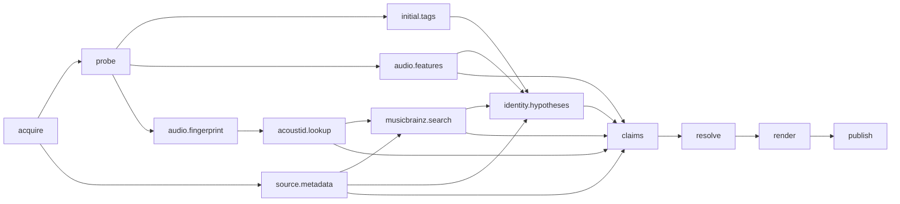

# 03. Pipeline

> Статус: **черновик v0.3**. Детализирует конвейер из `00-vision.md` и `02-architecture.md`.
> Цель — описать execution model так, чтобы resume, кэш, деградация и добавление новых шагов не были «магией».

## 1. Что здесь фиксируется

- Стадии от `SourceRef` до `LibraryEntry`.
- Типы артефактов и их манифесты.
- Как строится DAG из capability-манифестов.
- Как считается кэш и как работает resume.
- Что считается ошибкой, деградацией и review.
- Как ведут себя конкурентность, лимиты и отмена.

Код не пишется; ниже — контракты и псевдокод для планировщика/исполнителя.

## 2. Стадии


| Стадия | Вход | Выход | Side effects | Кэш |
|---|---|---|---|---|
| **Plan** | `SourceRef`, профиль, желаемые outputs | `Plan`: кандидаты, DAG, оценки стоимости | Нет (кроме чтения источника) | По source + config |
| **Acquire** | `Candidate` | `Intake`, `MediaObject` в CAS, `SourceSnapshot` | Сеть/диск | По source id + формату |
| **Observe** | `MediaObject`, `SourceSnapshot`, профиль | `Observation[]`, включая `audio.probe.v1` и `initial.tags.v1` | Сеть/CPU | По media hash + observer/version/params |
| **Interpret** | `Observation[]` | `Claim[]`, `IdentityHypothesis[]` | CPU/LLM | По хэшам наблюдений + interpreter/version/prompt |
| **Resolve** | claims, policies, locks, режим | `DecisionRecord` | CPU/LLM | По claims + policy version + overrides |
| **Render** | decisions, media, формат | `OutputBundle` (audio, cover, lyrics, sidecar) | Диск | По decisions + renderer/version/options |
| **Publish** | bundle, library root | `LibraryEntry` | Диск/БД | По bundle hash + target path |

### 2.1. Plan

Задачи:

1. Определить тип входа: локальный файл/папка, URL, текст.
2. Найти `SourceResolver`, который поддерживает вход.
3. Получить `Candidate[]` или `Collection`.
4. Применить пользовательский выбор/политику (для MVP — интерактивный выбор или лучший вариант).
5. Определить желаемые outputs и профиль анализа.
6. Построить DAG (см. §4).
7. Оценить стоимость/время/деградацию.
8. Вернуть `Plan` (можно показать в CLI и сохранить).

`Plan` не скачивает и не анализирует. Если required output недостижим (например, нет ни одного способа получить файл), план помечается `blocked` с причиной.

### 2.2. Acquire

Задачи:

1. Выбрать `Candidate` (формат/качество/язык).
2. Скачать/скопировать байты во временное место.
3. Посчитать SHA-256, проверить размер/целостность.
4. Положить в CAS (immutable).
5. Сохранить `SourceSnapshot` (info.json/HTML/API response) и `Intake`.
6. Зафиксировать `MediaObject` (контейнер/кодек/длительность — после probe).
7. Очистить временные файлы (кроме debug-режима).

Идемпотентность:

- ключ — `source_id + candidate_format + downloader_version`;
- если `MediaObject` с таким хэшем уже есть, повторно не качаем;
- если `Intake` уже существует и файл в CAS валиден, возвращаем его.

### 2.3. Probe (первый observer внутри Observe)

Probe — не отдельная стадия верхнего уровня, а первый обязательный observer. В DAG это узел `ffprobe`; его результат кэшируется как обычное наблюдение.

- `ffprobe -show_format -show_streams -of json`.
- Извлекаем: контейнер, кодек, bitrate, sample rate, channels, duration, tags, chapters, attached pictures.
- Результат — `audio.probe.v1`.
- Probe не меняет файл и не доверяет тегам; теги — отдельное наблюдение `initial.tags.v1`.

### 2.4. Observe

Наблюдения делятся на:

- **intrinsic** — можно получить из байтов: probe, fingerprint, acoustic features, ASR, stems, initial tags, embedded art.
- **extrinsic** — требуют сети: source metadata, MusicBrainz, AcoustID lookup, cover art, lyrics, web search.

Каждый observer:

- получает `ObservationContext` (media, source snapshot, profile, параметры);
- возвращает один или несколько `Observation`;
- не пишет финальные теги;
- фиксирует warnings и стоимость.

Примеры артефактов:

```text
source.metadata.v1
initial.tags.v1
audio.probe.v1
audio.fingerprint.v1
acoustid.lookup.v1
musicbrainz.search.v1
audio.features.v1
asr.transcript.v1
audio.stems.v1
cover.candidates.v1
lyrics.candidates.v1
```

### 2.5. Interpret

Интерпретаторы превращают наблюдения в claims/гипотезы:

- `kind.classifier` — music/audiobook/podcast/talk/other;
- `derivative.detector` — nightcore/remix/cover/sped up/...;
- `identity.resolver` — recording/release/artist hypotheses;
- `metadata.extractor` — title/artist/album/date/genre из source description/LLM;
- `lyrics.merger` — слияние правильного текста с таймингами;
- `cover.ranker` — выбор обложки;
- `transcript.aligner` — LRC/ELRC.

Интерпретатор не выбирает финал; он создаёт claims с provenance. Если интерпретация не уверена — это нормально; claim может иметь низкий confidence или не создаваться.

### 2.6. Resolve

Резолвер:

1. Собирает claims по полям.
2. Применяет locks (пользовательские).
3. Применяет `FieldPolicy` (source priority, authority, consensus, ranker, LLM, derive, review).
4. Валидирует значения.
5. Формирует `DecisionRecord` с альтернативами и rationale.
6. Отмечает `unknown`/`needs_review`.

Режимы: `policy`, `llm_assisted`, `llm_autopilot`, `manual` (см. `01-domain-model.md`).

### 2.7. Render

1. Взять `DecisionRecord` + `MediaObject`.
2. Выбрать target format (MP3/M4A/FLAC/OGG/Opus) и naming template.
3. Собрать аудио:
   - remux без перекодирования, если возможно;
   - transcode только если нужен target format/качество;
   - сохранить оригинальные байты в CAS.
4. Записать теги (canonical → format mapping).
5. Встроить/положить обложку.
6. Записать lyrics (sidecar/embed).
7. Записать sidecar `trackforge.json`.
8. Проверить чтением (read-back), что теги/файл валидны.

Render не публикует; он создаёт `OutputBundle` во временной/рабочей директории.

### 2.8. Publish

1. Проверить bundle hash/валидность.
2. Определить целевой путь в managed library.
3. Атомарно скопировать/переместить (temp + rename).
4. Обновить `LibraryEntry` и каталог.
5. При коллизии — суффикс/вариант, не перезаписывать чужой файл.
6. Опционально — hardlink/symlink, но по умолчанию копия.

Publish идемпотентен по `bundle_hash + target_path`.

## 3. Артефакты

### 3.1. Манифест

```text
Artifact:
  id
  type                  # audio.probe, source.metadata, acoustid.lookup...
  schema_version
  producer              # capability id + version
  inputs[]              # artifact ids / media hash
  params                 # нормализованные параметры (для provenance/debug)
  params_hash
  payload_hash
  payload_ref           # путь в workspace/CAS
  warnings[]
  created_at
  expires_at?           # для внешних данных
  license?              # для моделей/данных, если важно
```

### 3.2. Формат payload

- JSON (UTF-8, canonical: sorted keys, no NaN/Infinity).
- Большие бинарники (аудио, изображения) — отдельные файлы в CAS/workspace; в JSON — ссылка + хэш.
- Схемы версионируются; несовместимое изменение → новый `schema_version`.
- Валидация при записи и чтении.

### 3.3. Типы артефактов (MVP)

| Тип | Кто создаёт | Что внутри |
|---|---|---|
| `source.snapshot.v1` | Source/acquirer | сырой ответ источника, URL, headers, fetched_at |
| `source.metadata.v1` | Source adapter | title, uploader, description, tags, date, thumbnails |
| `audio.probe.v1` | ffprobe | контейнер, потоки, duration, chapters, attached pictures |
| `initial.tags.v1` | tag reader | существующие теги (как наблюдение) |
| `audio.fingerprint.v1` | Chromaprint | fingerprint, duration |
| `acoustid.lookup.v1` | AcoustID | candidates, scores, MBIDs |
| `musicbrainz.search.v1` | MusicBrainz | recordings/releases/artists, raw + normalized |
| `audio.features.v1` | librosa/essentia | bpm, key, loudness, spectral, etc. |
| `asr.transcript.v1` | faster-whisper | segments, words, language, confidence |
| `audio.stems.v1` | Demucs | stem ratios/features (не сами стемы, если не нужны) |
| `cover.candidates.v1` | CAA/iTunes/Deezer | URL, size, source, score |
| `lyrics.candidates.v1` | LRCLIB/Genius | plain, LRC, source, language |
| `identity.hypotheses.v1` | interpreter | hypotheses + evidence |
| `claims.v1` | interpreter | список claims |
| `decisions.v1` | resolver | DecisionRecord |
| `output.bundle.v1` | renderer | files + hashes + sidecar |

### 3.4. Где хранить

```text
artifacts/<cache_key>/
  manifest.json
  payload.json

items/<item_id>/
  item.json
  intake.json
  claims.json
  decisions/
  renders/
```

Артефакты — общий кэш по `cache_key`; item workspace ссылается на них и хранит снимки для portability. CAS — только байты. Манифест артефакта можно перечитать без БД.

## 4. Capability manifests и DAG

### 4.1. Манифест

```text
CapabilityManifest:
  id
  version
  kind                   # observer | interpreter | provider | ranker | renderer
  requires[]             # ArtifactType / field
  provides[]             # ArtifactType / field
  cost                   # cpu_seconds, memory_mb, network_calls, money_usd
  determinism            # deterministic | seeded | non_deterministic
  cacheable
  side_effects           # network | disk | none
  rate_limit             # host(s), requests/sec
  config_schema
  license
```

### 4.2. Алгоритм планирования

```text
plan(desired_outputs, profile):
  required_types = types_needed_for(desired_outputs)
  selected = profile.enabled ∩ available_capabilities
  graph = {}
  for type in required_types:
      chain = provider_chain(type, profile)
      add chain nodes + fallback edges
  for capability in selected:
      for req in capability.requires:
          ensure req is provided by some selected capability or input
      add edges(req.provides -> capability)
  if cycle: error
  if missing required: blocked
  apply budget: drop optional capabilities that exceed budget, record warnings
  return topological_plan(graph)
```

### 4.3. Provider chains

Цепочка — упорядоченный список провайдеров для одного типа артефакта. Планировщик включает все варианты, исполнитель идёт по ним при ошибке/пустом результате.

Примеры:

```text
identity:
  acoustid.lookup -> musicbrainz.search -> ranker -> llm
lyrics:
  lrclib -> genius -> asr
cover:
  cover_art_archive -> itunes -> deezer -> source.thumbnail
metadata:
  source.metadata -> musicbrainz -> llm
```

### 4.4. Пример DAG для одного трека



Опциональные ветки (ASR, stems, cover, lyrics) добавляются профилем и не ломают основной граф.

### 4.5. Бюджет

- `max_cpu_seconds` на item.
- `max_network_calls` / per-host rate.
- `max_cost_usd` для LLM.
- `max_memory_mb`.
- При превышении: optional steps → `skipped/degraded`; required → `blocked`.
- Бюджет можно задать в профиле/CLI.

## 5. Кэш

### 5.1. Ключ

```text
cache_key = sha256(
  canonical_json({
    "inputs": [artifact_hashes...],
    "capability": {"id": ..., "version": ...},
    "params": normalized_params,
    "config": relevant_config_subset,
    "model": {"id": ..., "version": ...} | null,
    "prompt": {"id": ..., "version": ...} | null
  })
)
```

`relevant_config_subset` определяется манифестом capability: например, для probe — `ffprobe_path/version`; для LLM — `model/temperature/max_tokens`; для render — `target_format/naming/tag_mapping_version`.

### 5.2. Правила

- Сначала `ArtifactStore.find(cache_key)`.
- Если найден и схема совместима — `cached`, шаг не выполняется.
- Если схема несовместима — пересчёт (или миграция, если есть).
- Non-deterministic шаги кэшируются только при наличии seed/модели/версии; иначе — `cacheable=false`.
- Внешние данные имеют `fetched_at`/`expires_at`; `--refresh` игнорирует TTL.
- Ошибки не кэшируются; negative cache не используем в v1.
- `--force step1,step2` игнорирует кэш только для указанных шагов.
- Кэш общий для items с одинаковым media hash (например, дубликаты).

### 5.3. Инвалидация

- Изменение версии capability.
- Изменение модели/промпта.
- Изменение релевантных параметров/конфига.
- Изменение входного артефакта.
- Явный `--refresh`.
- TTL для внешних источников (опционально).

## 6. Resume и состояние

### 6.1. Состояния

```text
Run:
  planned -> running -> paused -> completed
                     -> failed
                     -> cancelled

Step:
  pending -> ready -> running -> succeeded
                            -> failed
                            -> skipped
                            -> cached

Item:
  discovered -> acquired -> observed -> interpreted -> resolved
             -> rendered -> published
             -> needs_review | failed | duplicate | archived
```

### 6.2. Чекпоинты

- После каждого шага: artifact + `Step` status + `Run` progress.
- Перед шагом: `Step.status=running`, `attempts++`.
- При падении процесса: на старте `Run` в `running` считается «подозрительным»; проверяем артефакты.
- Если артефакт валиден — шаг помечается `cached/succeeded`; иначе — `pending` и повтор.
- Acquire: если файл в CAS есть и хэш совпадает — не качаем.
- Publish: если `LibraryEntry` уже есть и файл совпадает — не копируем.

### 6.3. Команды

```text
trackforge run <source>          # новый run
trackforge resume <run-id>       # продолжить
trackforge cancel <run-id>       # отменить
trackforge status <run-id>       # показать шаги
trackforge retry <run-id> --step <id>
```

### 6.4. Блокировки

- File lock на data dir, чтобы два процесса не писали одновременно.
- Внутри процесса — per-item lock.
- При конкурентном запуске второй процесс ждёт или завершается с понятной ошибкой.

## 7. Деградация

### 7.1. Классы outputs

| Класс | Примеры | Поведение при неудаче |
|---|---|---|
| **required** | выходной файл | `failed`; ничего не публикуем |
| **desired** | title, artist | `unknown`; файл всё равно создаём; warning |
| **optional** | bpm, key, genre, lyrics, cover, mood, language | `degraded`; warning; поле `unknown` |

### 7.2. Причины

- анализатор отключён профилем;
- провайдер недоступен/сломан;
- rate limit;
- нет модели/памяти;
- нет подходящих данных;
- ошибка валидации.

### 7.3. Видимость

Каждый `degraded/skipped` шаг пишет:

```text
Warning:
  code                  # provider_unavailable | rate_limited | disabled |
                        # no_data | model_missing | budget_exceeded | invalid_output
  message
  capability_id
  provider?
  retryable
  user_action?
```

Warnings попадают в `RunResult`, `DecisionRecord`, sidecar и CLI-отчёт.

### 7.4. Примеры

- Нет сети → `source.metadata`/MB/AcoustID `degraded`; локальные фичи и existing tags остаются; title/artist могут быть `unknown`.
- Нет Demucs → `audio.stems` `skipped`; derivative-детектор использует темп/метаданные.
- Нет ASR → lyrics из LRCLIB/Genius; если нет — `unknown`.
- Нет облачной LLM → 0.5B fallback (classification/ranking) → cross-encoder → lexical; если нет — policy/unknown.
- Нет ffmpeg → `failed` (required dependency); `doctor` должен поймать раньше.

## 8. Конкурентность и ресурсы

- **I/O** — `asyncio` + `httpx` + семафоры.
- **CPU** — `ProcessPoolExecutor`; `max_workers = min(cpu_count - 1, config)`.
- **Модели** — `ModelManager`: lazy load, max N heavy models, unload по LRU.
- **Память** — оценка до загрузки; при нехватке — `skipped/degraded` с warning.
- **Сеть** — per-host rate limiter; глобальный лимит; retry с jitter.
- **Отмена** — cooperative: проверка `cancelled` между шагами; текущий CPU-шаг завершается; процесс не убиваем без нужды.
- **Backpressure** — не запускать больше шагов, чем позволяет бюджет/память.

## 9. Точки взаимодействия с пользователем

| Точка | Когда | Что показывает | Можно ли автоматизировать |
|---|---|---|---|
| Выбор кандидата | Plan/Acquire | формат, качество, размер, язык | Да, политикой «лучший» |
| Выбор коллекции | Plan (плейлисты) | список треков, пропуски | Позже |
| Review | Resolve/Render | diff по полям, альтернативы, rationale | Да, `--auto` |
| Correction | Review/после | изменить значение, scope, lock | Нет (это действие пользователя) |
| Publish conflict | Publish | существующий файл, варианты | Да, суффикс |
| Деградация | В любой момент | warnings, что пропущено | Да, профилем |

MVP: интерактивный выбор кандидата и review для спорных; `--auto` — без вопросов, с `unknown`/warnings.

## 10. Пример: один URL

1. **Plan.**
   - `YtDlpSource.supports(url)` → true.
   - `resolve(url)` → `Candidate` list (audio formats, duration, title, uploader).
   - Пользователь выбирает `bestaudio`/рекомендованный.
   - `Plan` содержит acquire → observe (probe first) → interpret → resolve → render → publish.
2. **Acquire.**
   - `yt-dlp` subprocess скачивает audio-only во временную папку.
   - SHA-256 → CAS.
   - `SourceSnapshot` = `info.json` + URL + fetched_at.
   - `Intake` создан.
3. **Observe (probe first).** `audio.probe.v1`; `initial.tags.v1`.
4. **Observe (remaining).**
   - `source.metadata.v1`;
   - `audio.fingerprint.v1` → `acoustid.lookup.v1`;
   - `musicbrainz.search.v1`;
   - `audio.features.v1`;
   - `cover.candidates.v1`;
   - `lyrics.candidates.v1`;
   - `asr.transcript.v1` (если профиль full);
   - `audio.stems.v1` (если профиль full).
5. **Interpret.**
   - `kind=music`;
   - `derivative=nightcore` (метаданные + темп);
   - identity hypotheses: recording X, derivative Y;
   - claims: recording.title/artist, derivative.title/uploader, release.title, collection.title.
6. **Resolve.**
   - mode=policy (или autopilot);
   - title = `Song (Nightcore)` (derived);
   - artist = `Artist` (authority);
   - album = `Album` (album-first);
   - cover = CAA front;
   - bpm/key/genre;
   - locks применяются.
7. **Render.**
   - `Artist - Song (Nightcore).m4a`;
   - tags + cover + LRC + sidecar;
   - read-back.
8. **Publish.**
   - копия в `library_dir/...` (flat для одиночного; подпапка коллекции для плейлиста/альбома);
   - `LibraryEntry`.
9. **Feedback.**
   - пользователь меняет artist → `Correction` + claim + lock (по выбору).
10. **Повторный запуск.**
    - acquire/observe/interpret — cache hits;
    - resolve пересчитывается с учётом lock;
    - render/publish — новый bundle.

## 11. Пример: локальный файл

1. `LocalFileSource` поддерживает путь.
2. `Acquire` копирует байты в CAS (не меняя исходник).
3. `initial.tags.v1` — существующие теги как наблюдение; **не стираем** их из файла.
4. `audio.fingerprint.v1` → AcoustID/MusicBrainz.
5. Path/folder — дополнительное наблюдение (например, `Artist/Album/Track.mp3`).
6. Дальше — как с URL, без сети на acquire.

## 12. Матрица ошибок

| Стадия | Ошибка | Retryable | Действие | Итог |
|---|---|---|---|---|
| Plan | Unsupported source | Нет | Сообщить, предложить plugin | `failed` |
| Plan | Нет кандидатов | Нет | Сообщить | `failed` |
| Acquire | Сеть/таймаут | Да | Retry/backoff | `failed`/`degraded` |
| Acquire | Cookies expired | Нет | Попросить обновить cookies | `failed` |
| Acquire | Rate limit | Да | Ждать/retry | `degraded` |
| Observe (ffprobe) | ffmpeg отсутствует | Нет | `doctor` | `failed` |
| Observe | Провайдер 5xx | Да | Retry, затем fallback | `degraded` |
| Observe | Нет данных | Нет | Fallback/unknown | `degraded` |
| Interpret | LLM invalid JSON | Да | Retry 1, затем ranker/policy | `degraded` |
| Resolve | Нет валидного claim | Нет | `unknown`/review | `needs_review` |
| Render | Tag write error | Нет | Не публиковать | `failed` |
| Render | Нет места | Да | Очистить/сообщить | `failed` |
| Publish | Коллизия пути | Нет | Суффикс/review | `published`/`needs_review` |
| Publish | Permission denied | Нет | Сообщить | `failed` |

## 13. Наблюдаемость

- `run.jsonl` — события: `run.started`, `step.started`, `step.cached`, `step.finished`, `step.failed`, `run.finished`.
- В каждом событии: `run_id`, `item_id`, `step_id`, `capability`, `provider`, `duration_ms`, `status`, `warning_codes`.
- Секреты/куки/токены не логируются.
- `--debug` сохраняет сырые ответы провайдеров (redacted) в `debug/`.
- Метрики: cache hit rate, provider latency, token/cost, CPU time, degraded rate.
- `doctor` проверяет окружение до запуска.

## 14. Тестирование pipeline

- DAG: циклы, missing providers, fallback chains, budget.
- Cache: hit/miss, version invalidation, TTL, `--force`.
- Resume: падение между шагами, невалидный артефакт, повторный publish.
- Degradation: нет сети, нет модели, нет ffmpeg, невалидный LLM.
- Concurrency: лимиты, отмена, file lock.
- Golden artifacts: стабильные JSON-схемы.
- Integration: один локальный трек end-to-end (без сети) + один URL (optional, network).

## 15. Открытые вопросы

- Дефолтный профиль: `balanced` или `full`? Предложение: `balanced`, `full` — явно.
- Какая cross-encoder модель и её лицензия/размер? После CPU-бенчмарка.
- Параллельная обработка нескольких item'ов — после MVP.
- Negative caching ошибок — не используем в v1.
- Политика retention артефактов (сколько хранить, когда чистить).
- Нужен ли `Plan` как сохраняемый артефакт с версией (скорее да).
