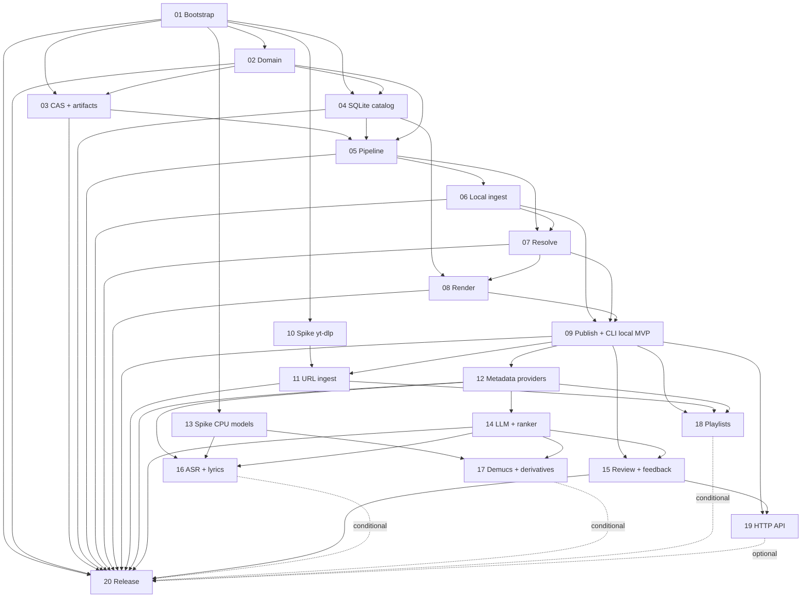

# TrackForge — план исполнения

> Индекс исполняемых планов для coding-агентов. Каждый `NN-*.md` — самодостаточный промпт для одного чистого контекста.
> Проектные документы: [`../design/`](../design/README.md). Исходная идея: [`../reflection/start-ideas.md`](../reflection/start-ideas.md).
> Мета-инструкция: [`00-META-PROMPT.md`](00-META-PROMPT.md) — не изменяется и не является планом.
## 1. Назначение

Этот каталог превращает проектную документацию v0.3 в последовательность небольших проверяемых работ: от пустого `src/` до релиза v1.0. План — это **промпт**, а не эссе: агент читает перечисленные файлы, выполняет scope, прогоняет проверки и оставляет репозиторий зелёным.

Текущее состояние репозитория: есть только проектные документы; `src/`, `tests/`, `pyproject.toml` и CI отсутствуют. Это ожидаемое стартовое состояние.

## 2. Как читать и запускать

1. Открой план `01-bootstrap.md` и прочитай его целиком.
2. Проверь раздел «Предусловия»; при невыполнении — остановись и сообщи, не «чини» чужие планы.
3. Выполни только scope плана. Не добавляй future-фичи и не меняй `docs/design/`.
4. Прогони команды из раздела «Проверка». Все обязательные проверки должны быть зелёными.
5. Закрой acceptance criteria, сделай коммит, зафиксируй handoff.
6. Переходи к следующему плану только после зелёного состояния и коммита.

Один план — один PR/коммит (или небольшая серия коммитов в рамках одного результата). Незакоммиченное состояние предыдущего агента не должно быть предусловием следующего плана.

## 3. Правила выполнения

- **Чистый контекст.** План не ссылается на переписку; только файлы, команды и артефакты.
- **Один основной результат.** Если по ходу выясняется, что результатов два, — остановись и предложи split, не расширяй scope.
- **Зависимости только назад.** План `NN` может зависеть от `NN-1`, `NN-2`, но не от `NN+1`.
- **Репозиторий зелёный.** `ruff`, `mypy`, `pytest`, `lint-imports` — обязательны; integration/slow/network — по маркерам.
- **Тесты не ходят в сеть по умолчанию.** HTTP-адаптеры — `respx`/кассеты; live — `@pytest.mark.network`, не в CI.
- **Секреты.** Только placeholder'ы и имена env-переменных; cookies/токены не коммитить и не логировать.
- **Лицензии.** Новые зависимости — с лицензией и местом (core/extra/plugin). Ядро не импортирует GPL/AGPL.
- **Никаких TBD.** Нерешённое — `Decision gate` в этом README или в плане; если выбор блокирует работу — стоп.
- **Deferred явно.** Всё отложенное помечается `Deferred` с причиной, а не молчаливым «потом».
- **Проектные документы не меняются.** Планы могут ссылаться на `docs/design/`, но не редактируют его.
- **Артефакты spike.** Результаты — в `docs/plan/artifacts/NN-<slug>.md`; production-код spike не пишет.

## 4. Границы MVP, post-MVP и релиза

- **Локальный MVP (milestone):** Plans 01–09. Локальный файл → CAS → observations → claims/decisions → output с тегами, обложкой, sidecar → managed library. CLI `import`, `review`, `explain`, `doctor`.
- **MVP-релиз (Q2: «один трек из любого источника»):** Plans 01–12. Добавляются один URL через `yt-dlp` и опциональные metadata providers (MusicBrainz/AcoustID/CAA/LRCLIB).
- **Post-MVP:** Plans 14–18 — LLM/ranker, расширенный feedback, ASR/lyrics, Demucs/derivatives, плейлисты.
- **Optional:** Plan 19 — локальный HTTP API; GUI осознанно `Deferred` до v1.1.
- **Релиз:** Plan 20 — hardening, license/security audit, backup/GC, упаковка, smoke, v1.0. Планы 16–18 входят в релиз только при зелёном go/no-go; 19 не блокирует релиз.

## 5. Статусы и типы

| Поле | Значения |
|---|---|
| `Статус` | `ready` — можно запускать после предусловий; `conditional` — зависит от spike/внешнего ресурса; `blocked` — нет решения; `deferred` — сознательно отложен |
| `Тип` | `MVP`, `Post-MVP`, `Spike`, `Optional` |
| `Оценка` | `S` — до 1 сессии; `M` — 1–2; `L` — 2–3 |

## 6. Таблица планов

| # | План | Тип | Статус | Зависит от | Разблокирует | Оценка | Результат |
|---:|---|---|---|---|---|---|---|
| 01 | [Bootstrap и quality gates](01-bootstrap.md) | MVP | ready | — | 02, 03, 04, 10, 13 | M | `uv`-проект, src layout, config, CLI, lint/type/test/import-linter, CI |
| 02 | [Domain core](02-domain-core.md) | MVP | ready | 01 | 03, 04, 05 | L | Чистые доменные сущности, инварианты, ID, ошибки |
| 03 | [CAS и artifact store](03-cas-artifact-store.md) | MVP | ready | 02 | 05, 06 | M | Неизменяемые байты, manifest/payload, cache-key, read-back |
| 04 | [SQLite-каталог и миграции](04-sqlite-catalog.md) | MVP | ready | 02 | 05 | L | Схема MVP, Alembic, репозитории, locks, file lock |
| 05 | [Pipeline engine](05-pipeline-engine.md) | MVP | ready | 02, 03, 04 | 06, 07 | L | Capability DAG, planner/executor, cache, resume, degradation, events |
| 06 | [Local ingest + probe](06-local-ingest-probe.md) | MVP | ready | 05 | 07, 09 | L | Локальный файл → CAS → `audio.probe.v1` + `initial.tags.v1` |
| 07 | [Resolution core](07-resolution-core.md) | MVP | ready | 05, 06 | 08, 09 | L | Claims → policy → `DecisionRecord`, locks, unknown, explain |
| 08 | [Render + tag writer](08-render-tag-writer.md) | MVP | ready | 04, 07 | 09 | L | MP3/M4A/FLAC/OGG/Opus, cover, LRC sidecar, sidecar JSON, read-back |
| 09 | [Publish + CLI local MVP](09-publish-cli-local-mvp.md) | MVP | ready | 06, 07, 08 | 11, 12, 15, 18, 19 | L | `trackforge import` → managed library; review/explain/doctor; local E2E |
| 10 | [Phase 0 spike: yt-dlp/Deno/cookies](10-spike-ytdlp.md) | Spike | conditional | 01 | 11 | M | Benchmark-отчёт и go/no-go по одному URL |
| 11 | [URL ingest через yt-dlp](11-url-ingest-ytdlp.md) | MVP | conditional | 09, 10 | 12, 18 | L | URL → candidate → download → CAS → библиотека; `add`/`plan` |
| 12 | [Metadata providers](12-metadata-providers.md) | MVP | ready | 09 | 14, 16, 18 | L | MusicBrainz/AcoustID/CAA/LRCLIB, rate limits, cache, fallback |
| 13 | [Phase 0 spike: CPU-модели](13-spike-cpu-models.md) | Spike | conditional | 01 | 14, 16, 17 | L | Benchmark Whisper/Demucs/cross-encoder и go/no-go |
| 14 | [LLM + ranker](14-llm-ranker.md) | Post-MVP | ready | 12 | 15, 16, 17 | L | OpenAI-compatible provider, prompts, modes, lexical/cross-encoder ranker |
| 15 | [Review + feedback](15-review-feedback.md) | Post-MVP | ready | 09, 14 | 19 | M | Corrections, locks, review sessions, export/stats, context snapshot |
| 16 | [ASR + lyrics](16-asr-lyrics.md) | Post-MVP | conditional | 12, 13, 14 | — (vocal path для 17) | L | faster-whisper, `asr.transcript.v1`, LRC/ELRC, merge |
| 17 | [Demucs + derivatives](17-demucs-derivatives.md) | Post-MVP | conditional | 13, 14 | — | L | Stems features, vocal/derivative detector, opt-in `full` |
| 18 | [Playlists/collections](18-playlists.md) | Post-MVP | conditional | 09, 11, 12 | — | L | Playlist → выбор → очередь → resume → подпапка; `tag_basis` |
| 19 | [HTTP API (GUI deferred)](19-http-gui.md) | Optional | ready | 09, 15 | — | M | FastAPI/SSE поверх `AsyncTrackForge`, local token, без бизнес-логики |
| 20 | [Hardening + release v1.0](20-release.md) | MVP | ready | 01–15; 16–18 conditional; 19 optional | релиз | L | Security/license audit, backup/GC, упаковка, smoke, CHANGELOG, v1.0 |

## 7. Граф зависимостей

## 8. Coverage matrix

| Design doc | Планы | Что проверяется |
|---|---|---|
| [`design/README.md`](../design/README.md) | 01, 20 | Карта документов, процесс, статус v0.3 |
| [`00-vision.md`](../design/00-vision.md) | 01, 02, 05, 07, 09, 11, 20 | Инварианты evidence-driven, managed library, границы v1, релиз |
| [`01-domain-model.md`](../design/01-domain-model.md) | 02, 06, 07, 08, 09, 15, 18 | Item/Media/Intake, claims/decisions, feedback, collection, sidecar |
| [`02-architecture.md`](../design/02-architecture.md) | 01, 02, 03, 04, 05, 09, 11, 12, 14, 19, 20 | Слои, порты/адаптеры, composition root, GPL boundary |
| [`03-pipeline.md`](../design/03-pipeline.md) | 03, 05, 06, 07, 08, 09, 14, 16, 17, 18 | DAG, cache, resume, degradation, events, повторный запуск |
| [`04-storage.md`](../design/04-storage.md) | 03, 04, 08, 09, 15, 20 | CAS, artifacts, SQLite-схема, locks, sidecar, backup/GC |
| [`05-sources.md`](../design/05-sources.md) | 06, 10, 11, 12, 18 | LocalFileSource, yt-dlp, cookies, rate limits, playlists |
| [`06-analysis.md`](../design/06-analysis.md) | 06, 07, 12, 13, 14, 16, 17 | Probe/tags/features, MB/AcoustID, Whisper, Demucs, ranker; Essentia deferred |
| [`07-resolution.md`](../design/07-resolution.md) | 07, 09, 12, 14, 15, 18 | Нормализация, стратегии, locks, LLM-режимы, playlist context |
| [`08-metadata.md`](../design/08-metadata.md) | 08, 09, 12, 16, 17 | Канонические поля, ID3/MP4/Vorbis, cover, LRC sidecar, naming |
| [`09-interfaces.md`](../design/09-interfaces.md) | 01, 09, 11, 14, 15, 19 | Python API, CLI, DTO, ошибки, будущий HTTP; GUI deferred |
| [`10-operations.md`](../design/10-operations.md) | 01, 04, 09, 11, 12, 20 | Config/secrets, XDG, permissions, doctor, logging, backup |
| [`11-quality.md`](../design/11-quality.md) | 01, 03, 08, 10, 13, 20 | Test pyramid, fixtures, CI, security, license audit, release checklist |
| [`12-roadmap.md`](../design/12-roadmap.md) | 01, 09, 11, 14, 16, 18, 20 | Phase 1–5, MVP scope, критерии готовности, риски |
| [`13-consistency-review.md`](../design/13-consistency-review.md) | 02, 04, 07, 20 | Probe как observer, claim_events, locks, renders, identity artifact-only |
| [`14-phase0-spikes-assessment.md`](../design/14-phase0-spikes-assessment.md) | 10, 13, 14, 20 | Go/no-go, benchmark-таблицы, выбор моделей, CPU/RAM бюджет |
| [`glossary.md`](../design/glossary.md) | 02 | Единые имена и значения терминов в коде/DTO |
| [`open-questions.md`](../design/open-questions.md) | README gates; 02, 04, 07, 11, 14, 15, 18, 19 | Q13, Q15, Q16, Q18, Q29–Q32 и decision gates |
| [`adr/0001`](../design/adr/0001-modular-monolith-hexagonal.md) | 01, 02, 05, 20 | Слои и import-linter |
| [`adr/0002`](../design/adr/0002-claims-decisions.md) | 02, 07, 15 | Claims/decisions/feedback, explainability |
| [`adr/0003`](../design/adr/0003-content-addressed-storage.md) | 03, 08, 09 | SHA-256 CAS, immutable bytes, производные |
| [`adr/0004`](../design/adr/0004-capability-dag-pipeline.md) | 05, 06 | Manifest, planner/executor, cache/resume |
| [`adr/0005`](../design/adr/0005-gpl-license-boundary.md) | 01, 03, 08, 20 | License boundary, optional extras, audit |
| [`adr/0006`](../design/adr/0006-llm-modes-ranker.md) | 14, 15 | Режимы, guardrails, ranker, DecisionRecord |

## 9. Decision gates

Рекомендация — дефолт для планов. Если пользователь не выбрал иное до старта блокируемого плана, агент следует рекомендации и фиксирует это в handoff.

| ID | Вопрос | Варианты | Рекомендация | Блокирует |
|---|---|---|---|---|
| D1 | Что считается MVP-релизом? | (a) только локальный файл; (b) локальный + один URL; (c) (b) + metadata providers | (c): Plans 01–12; providers opt-in, локальный путь работает offline; при URL no-go — 0.9 local-only | 09, 11, 12, 20 |
| D2 | Формат/генератор ID | (a) UUIDv7 внутренним генератором; (b) `uuid6`; (c) ULID | (a): RFC 9562, без новой зависимости | 02 |
| D3 | Доступ к SQLite | (a) SQLAlchemy 2 sync + Alembic, вызовы через `asyncio.to_thread`; (b) stdlib `sqlite3` + SQL-миграции; (c) async SQLAlchemy + `aiosqlite` | (a): миграции и репозитории без нового async-драйвера | 04 |
| D4 | Клиент MusicBrainz | (a) `httpx` напрямую; (b) `musicbrainzngs`; (c) оба | (a): один HTTP-стек и `respx`-кассеты, rate limit под контролем | 12 |
| D5 | Установка `mutagen` | (a) optional extra `[tagging]`; (b) core dependency | (a): license boundary; release ставит `trackforge[tagging]`, `doctor` проверяет | 08, 20 |
| D6 | Формат `--json` | (a) один JSON-объект на команду; (b) JSONL; (c) оба | (a) для команд, JSONL — только для потоков событий/`status --follow` | 09, 19 |
| D7 | Политика версии `yt-dlp` | (a) диапазон + `uv.lock` + `doctor`; (b) точный pin; (c) всегда latest | (a): диапазон с нижней границей, lock в репозитории, `doctor` предупреждает | 11 |
| D8 | Cross-encoder модель | (a) MiniLM multilingual QInt8; (b) BGE base; (c) только lexical | (a), если Plan 13 go; иначе (c) с warning | 14 |
| D9 | `tag_basis` по умолчанию | (a) `album_first`; (b) `playlist_first`; (c) `ask` | (a) с fallback на playlist/unknown при низкой уверенности | 18 |
| D10 | Scope v1.0 | (a) 01–12 + 14–15; (b) + 16–18 при go; (c) + GUI | (b): 16–18 при go, no-go — Deferred и не блокирует 1.0; 19 optional; URL no-go → 0.9 local | 20 |

## 10. Пробелы, противоречия и отклонения

1. **Окружение:** в текущей среде нет `uv`, `ffmpeg`, `ffprobe`, `fpcalc`, `deno`. Это не противоречие docs, но precondition для Plans 01, 06, 08, 10, 12, 13. Агент обязан остановиться, если инструмент недоступен, а не устанавливать системные пакеты без разрешения.
2. **Пустой `src/`:** кода, тестов и `pyproject.toml` нет — это ожидаемое состояние, а не gap. Plan 01 создаёт каркас. Phase 0 tag-round-trip/SQLite spikes не выделены отдельными планами: решения уже приняты, а проверки живут в Plan 08 (round-trip) и Plan 04 (миграции/lock).
3. **Phase 1 vs Q2:** `12-roadmap.md` называет Phase 1 «Local file MVP», а Q2 — MVP «локальный файл или одна ссылка». Это разные milestone'ы: локальный — Plan 09, MVP-релиз — после Plan 11/12 (D1). LLM (Plan 14) — post-MVP, хотя Q4 описывает его как default-режим; MVP использует `policy`.
4. **`schema_migrations` vs Alembic:** `04-storage.md` упоминает таблицу `schema_migrations`, Alembic использует `alembic_version`. Plan 04 использует Alembic как единственный механизм миграций; концептуальная таблица не дублируется.
5. **MusicBrainz client:** `05-sources.md` предлагает `musicbrainzngs`; Plan 12 по D4 использует `httpx` напрямую. Причина — единый HTTP-стек, кассеты, собственный rate limiter; публичный API MusicBrainz при этом не меняется.
6. **`mutagen` extra:** `02-architecture.md` и `10-operations.md` требуют extra `[tagging]`; Plan 08 следует этому, поэтому базовый install без extra не умеет render. `doctor` и release-инструкция обязаны это показывать; это осознанный license-boundary trade-off.
7. **Essentia:** `06-analysis.md` допускает AGPL-плагин; в v1.0 он **Deferred** (отдельный optional plugin после релиза), потому что не нужен для MVP и усложняет license audit.
8. **Local LLM 0.5B:** **Deferred** до post-v1; в v1.0 fallback — lexical/cross-encoder и policy/unknown. Это соответствует Q26 и `14-phase0-spikes-assessment.md`.
9. **GUI:** **Deferred** до v1.1. Plan 19 реализует только HTTP API/SSE; UI не входит в v1.0 (D10).
10. **Identity-сущности:** в v1 остаются artifact-only (claims + `identity.hypotheses.v1`), без нормализованных таблиц; это принятое упрощение из `13-consistency-review.md`, а не забытый gap.
11. **`--json`:** формат не был зафиксирован в `09-interfaces.md`; D6 задаёт дефолт. Если пользователь выберет JSONL, Plan 09/19 обновляют только CLI-контракт, не домен.
12. **Root `README.md`:** остаётся документом статуса проектирования до Plan 20; Plan 20 обновляет install/usage и статус релиза. `docs/design/` не меняется.
13. **`LICENSE`:** уже GPL-3.0-or-later; Plan 20 только проверяет, не меняет лицензию (SPDX-заголовки — Deferred).
14. **Plugin registry/entry points:** **Deferred** до v1.1. В v1.0 нет plugin SDK; `doctor`/HTTP не обещают список плагинов. Это соответствует правилу «плагины после MVP».

## 11. Порядок первого запуска

1. Установить/проверить `uv`, `ffmpeg`, `ffprobe`; при необходимости — `git` и Python 3.12.
2. Начать с [Plan 01](01-bootstrap.md): без каркаса, quality gates и config остальные планы не могут оставить репозиторий зелёным.
3. Далее строго по графу: 02 → 03 → 04 → 05 → 06 → 07 → 08 → 09.
4. После Plan 09 — локальный MVP; зафиксировать milestone и прогнать `trackforge import` на реальном локальном файле.
5. Перед Plan 11 выполнить Plan 10 (spike yt-dlp); при no-go — остановить URL-ветку, зафиксировать deferred и продолжить Plan 12/14/15 для локального пути.
6. Перед Plan 16/17 выполнить Plan 13 (spike CPU); при no-go — ASR/Demucs deferred, релиз без них.
7. Plan 14/15 — качество и feedback; Plan 18 — плейлисты; Plan 19 — optional HTTP; Plan 20 — релиз.

## 12. Артефакты

- [`artifacts/README.md`](artifacts/README.md) — правила заполнения.
- [`artifacts/10-spike-ytdlp.md`](artifacts/10-spike-ytdlp.md) — результаты Plan 10.
- [`artifacts/13-spike-cpu-models.md`](artifacts/13-spike-cpu-models.md) — результаты Plan 13.
- [`artifacts/14-llm-preflight.md`](artifacts/14-llm-preflight.md) — preflight Plan 14.
- [`artifacts/16-asr-benchmark.md`](artifacts/16-asr-benchmark.md) — benchmark Plan 16.
- [`artifacts/20-release-report.md`](artifacts/20-release-report.md) — release evidence Plan 20.

## 13. Блокеры

На момент создания плана блокеров нет. Все нерешённые вопросы либо закрыты рекомендацией decision gate, либо явно `Deferred`. Если при выполнении обнаружено противоречие, меняющее архитектуру, — стоп, запись в этот раздел и сообщение пользователю; `docs/design/` не редактировать.
